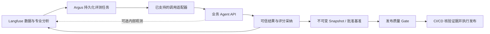
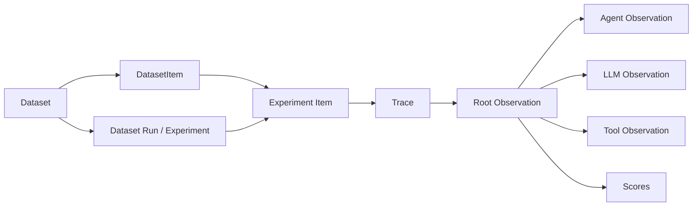
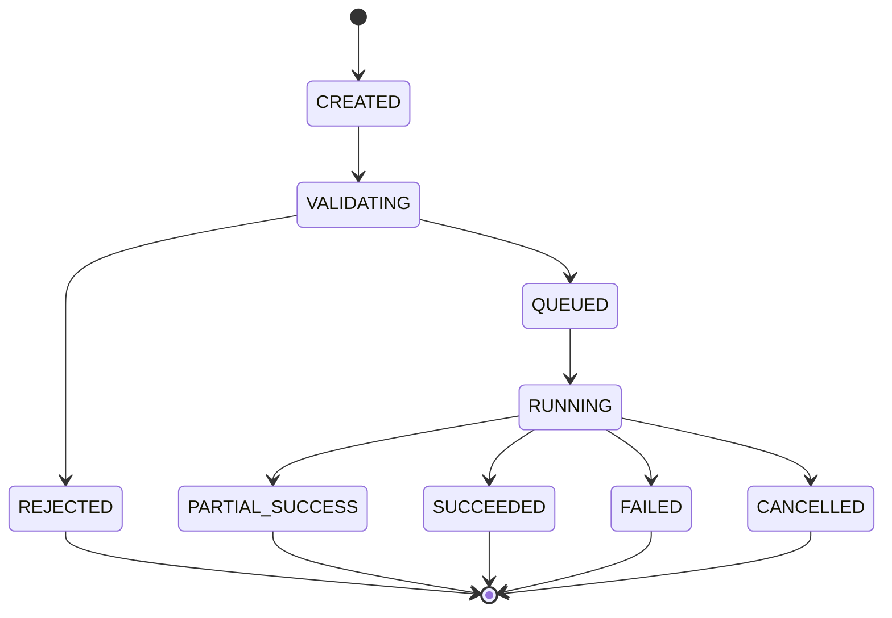
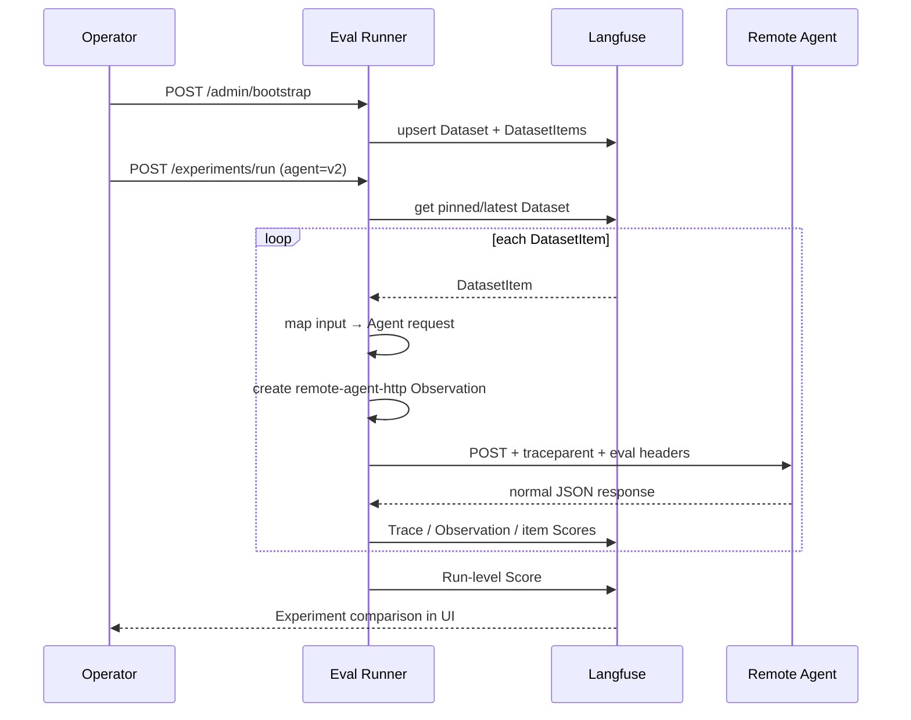

# Agent 评测桥接、持久化执行与发布质量证据技术设计

**文档版本：** 1.1（2026-10-27 产品边界收敛）
**状态：** 技术契约与历史 PoC 说明；新增治理目标待逐项实施/验收
**初始基线日期：** 2026-09-16
**方案：** Langfuse + 受治理评测桥接/执行控制面 + 发布质量证据/门禁

**范围入口：** [产品边界与需求准入](docs/product-boundaries.md)。本文件的“当前实现”不等于所有设计目标已交付，接口事实以 [OpenAPI](docs/openapi.json) 为准。

**S4 历史设计：** [轨迹评测方案集](docs/plans/2026-10-13-s4-trajectory/README.md) 作为历史契约/实现交接保留；深度轨迹与自建 Judge 不再默认串行为 v1.0 前置，按需求准入后复用。旧验收记录仍保留原提交和结果，不因收敛自动完成或失效。

---

## 1. 文档目的

定义已有 Agent 的外置评测接入、持久化执行、可信结果封存和发布质量判定。Argus 不替代 Agent Runtime、Langfuse 专业实验/观测产品或企业 CI/CD。

业务服务只要符合受支持调用契约，就不必内嵌评测 SDK；评测团队仍需维护适配、数据和策略。该架构也可以用 Langfuse SDK + 外置脚本实现，平台价值是集中维护与治理，不是独占技术能力。

保留可运行 PoC `Langfuse + Eval Runner + Demo Agent v1/v2`，但 Demo 通过不证明生产身份、权限、制品匹配或发布有效期保护已验收。

---

## 2. 背景与问题定义

独立脚本不必放在 Agent Repo 或业务进程中；Python/JS/TS 评测端可通过 HTTP 调用不同语言服务。Langfuse 已提供实验执行、比较、远程触发和基础 CI 门禁，不能把这些统一称为其能力缺口。

需要 Argus 的场景是：多团队适配反复维护、长任务需持久恢复、外部 Score 必须精确采纳、历史发布证据不能漂移，以及 CI 需要验证结论与实际候选/环境一致。价值需以接入成本与故障验收证明。

---

## 3. 设计目标

### 3.1 核心目标

- 复用现有 HTTP 接入/映射/凭证体系；新协议按消费者需求扩展。
- Launch/Attempt 持久化，故障恢复、取消/迟到隔离、评分重试与业务重放分离。
- 冻结用例、调用/评分/策略/环境与基准；严格验证外部证据来源，保存不可变结果修订。
- 提供可解释 PASS/FAIL/UNKNOWN、批准基准与 CI 质量门禁；正式发布身份/适用期核验须有独立契约与实测，不因登记版本号推断已实现。
- 复用企业身份/Secret/审批，实施资源授权、调用目标边界、最小审计与数据治理。

### 3.2 非目标与按需能力

- 不取代业务 Runtime、制品仓库、部署/灰度/回滚与最终发布授权。
- 不重建 Dataset/Prompt 编辑、通用 Trace/实验分析、在线采样/告警/人工标注。
- 不建设通用 DAG/审批引擎、IdP/Vault 或计费/多租户运营平台。
- 不默认开发通用深度轨迹、自建 Trajectory Judge 或穷尽框架/协议支持；复用已有安全规则与证据原语，按实际发布政策需求准入。
- 不长期 Fork Langfuse；已有 i18n 补丁兼容维护，不作为新核心能力依赖。

---

## 4. 架构原则

### P1. Evaluation Instrumentation = 0

业务 Agent 不需要：

```text
Langfuse Evaluation SDK
@Eval
DatasetRunner
Evaluator callback
Experiment API
```

Agent 只需要正常业务入口，例如：

```http
POST /api/v1/invoke
Content-Type: application/json
```

### P2. Observability 与 Evaluation 分离

如果 Agent 已有 OpenTelemetry，它可以接受 `traceparent`，从而把内部 LLM/Tool Span 关联到评测 Trace；如果 Agent 没有任何 Observability，平台仍然可以进行输入/最终输出级评测。

因此：

```text
Evaluation dependency = 0
Observability dependency = optional enhancement
```

### P3. 单一权威状态，冻结发布证据允许本地保存

Langfuse 拥有日常 Dataset/Prompt、Trace/Observation、在线评分和实验分析；Argus 拥有 Launch/Attempt、Release Snapshot、批准基准和质量决策。

本地冻结用例/摘要、最小评分证据与版本引用服务于发布审计，不构成另一套可变主数据。外部 Score 必须经过来源/尝试校验采纳；向 Langfuse 的发布结果为单向幂等投影。两侧不双向编辑，不用在线变化回填历史。

### P4. 持久化评测执行，不扩建通用编排

当前 Worker 在 Runner 内运行；业务状态进入既有 Store/Queue。复用状态机、锁和 generation，独立扩缩容只是按需部署演进，不要求重建第二套调度或拆微服务。

评分重试不得默认重调 Agent；有副作用的远程调用须有业务幂等/查询/隔离契约，否则超时不允许盲目重放，不能承诺远端 exactly-once。

### P5. Evaluation Context 不污染业务 Payload

评测元数据优先放入标准 Trace Context 和 HTTP Header，而不是强制修改 Agent DTO：

```http
traceparent: ...
baggage: ...
X-Eval-Launch-Id: ...
X-Eval-Dataset-Item-Id: ...
X-Eval-Agent-Version: ...
```

---

## 5. 总体架构



此为职责图，CI 制品身份/有效期核验属于 #7 的后续验收，不意味着当前已交付。Langfuse 托管评估是受验证的结果来源；必需评分未到不能判断通过，非关键展示投影失败不反向改变本地封存结论。

---

## 6. 为什么采用 Langfuse + Remote Runner

Langfuse SDK 本身可在外部任务函数调用业务 HTTP 服务，也有并发、故障隔离、评分、实验比较与 CI 门禁。Argus 不将这些当作独占能力。

选择统一控制面需要具体收益：共享协议/凭证适配、持久执行与恢复、版本/来源/覆盖率一致约束、批准基准和发布证据核验。已有 Langfuse/企业设施能满足的编辑、分析、审批与部署下沉集成，只有发布必需状态和最小证据归 Argus。

范围准入和官方参考见 [产品边界](docs/product-boundaries.md)。

---

## 7. Langfuse 数据模型映射

Langfuse v4 采用 Observation-first / OpenTelemetry 模型。平台侧建议按下列关系理解：



### 7.1 DatasetItem

DatasetItem 是“测试规范”，不应该存 Candidate Version 的运行结果。

推荐结构：

```json
{
  "input": {
    "messages": [{"role":"user","content":"查询异常交易"}],
    "customer_id": "C10001"
  },
  "expected_output": {
    "intent": "transaction_investigation",
    "required_tool": "transaction-query",
    "forbidden_fields": ["full_account_number"],
    "must_escalate": false
  },
  "metadata": {
    "domain": "banking",
    "risk_level": "medium"
  }
}
```

Candidate 的 output 属于 ExperimentItem / Trace。

### 7.2 一个 DatasetItem 一条 Trace

推荐：

```text
DatasetItem #123
  └─ ExperimentItem
      └─ Trace #abc
          ├─ Root experiment task
          ├─ remote-agent-http
          ├─ Agent/LLM/Tool spans (optional)
          └─ Scores
```

不建议将整个 Dataset Run 放在一条超大 Trace 中。

---

## 8. 企业扩展领域模型

Langfuse 原生对象不需要复制。企业侧只新增少量对象。

### 8.1 AgentDefinition

描述“一个可以被评测的平台 Agent”。

```json
{
  "id": "banking-agent",
  "name": "银行客服 Agent",
  "owner": "retail-banking-ai",
  "protocol": "HTTP_JSON",
  "risk_level": "high"
}
```

### 8.2 AgentVersion

描述“某一个可执行版本”。

```json
{
  "agent_id": "banking-agent",
  "version": "2.7.0",
  "endpoint": "http://banking-agent-v2.svc/api/v1/invoke",
  "auth_ref": "vault://agent-eval/banking-agent",
  "request_schema": {},
  "response_schema": {},
  "request_mapping": {
    "messages": "input.messages",
    "customer_id": "input.customer_id"
  },
  "execution_policy": {
    "timeout_ms": 120000,
    "max_concurrency": 20,
    "rate_limit_per_minute": 120,
    "max_retries": 2
  }
}
```

### 8.3 ExperimentLaunch

表示“用户希望平台按什么配置执行一次评测”，与最终 Langfuse Experiment 结果区分。

```json
{
  "launch_id": "...",
  "dataset": {"id":"...", "version":"..."},
  "target": {"agent_id":"banking-agent", "agent_version":"2.7.0"},
  "evaluators": ["correctness:v5", "policy:v12", "trajectory:v3"],
  "baseline_experiment_id": "...",
  "runner_version": "1.3.2",
  "execution_policy": {"max_concurrency":20, "timeout_ms":120000}
}
```

#### 8.3.1 冻结的 Evaluator 执行身份（Manifest schema 1.2）

Manifest 的 `evaluators[]` 在 schema 1.2 起不再是「id + version」，而是**冻结绑定**（`EvaluatorBinding`）：创建时冻结、执行前再次校验，保证「同一配置 = 同一实现 = 同一结果」。

```json
{
  "id": "intent_match",
  "version": "1.0.0",
  "binding_id": "bind_9f2c...",
  "definition_digest": "sha256:...",
  "implementation_ref": "builtin:intent_match@1.0.0",
  "executor_type": "builtin_python",
  "implementation_artifact": {
    "kind": "python_source",
    "locator": "app.evaluators:intent_match",
    "digest": "sha256:..."
  },
  "runner": {"runner_version": "0.1.0", "build_id": "..."},
  "binding_digest": "sha256:...",
  "contract_status": "FROZEN_VERIFIED",
  "verification_status": "RECORDED"
}
```

约束：

- `binding_digest` 由影响结果的字段规范化后计算（`sort_keys` 序列化），字段顺序不影响摘要，任一影响结果的变化都会改变摘要。
- 实现制品摘要必须来自**构建产物**（内置 Python 为实现源码 + 固定 `implementation_ref` + 版本化依赖的 SHA-256），不接受可变 tag 或任意环境变量字符串。
- 执行/恢复前统一经 `EvaluatorExecutor` 的 resolve / validate / execute 边界；版本缺失、制品不可解析、摘要不匹配或执行器不支持时**明确失败**（`EVALUATOR_VERSION_UNAVAILABLE` / `EVALUATOR_ARTIFACT_UNRESOLVABLE` / `EVALUATOR_ARTIFACT_DIGEST_MISMATCH` / `EVALUATOR_BINDING_DIGEST_MISMATCH` / `EVALUATOR_EXECUTOR_UNSUPPORTED`），质量结论保持 `UNKNOWN`，**不回退到其他版本**。
- schema 1.0 / 1.1 的历史 Manifest 显式读取并标记 `HISTORICAL_CONTRACT_UNRECORDED`（「历史契约未记录」）：仍可执行，但不宣称满足新的冻结资格。

#### 8.3.2 类型化评测结果（EvaluationResult）

`ExperimentItemExecution.scores` 只是**受限 numeric 投影**，不是事实来源。事实来源是 `evaluation_results` 表中每条类型化、可解释的结果：每个被选中的冻结 Binding 恰好产出一条。

支持的 `result_type`：`boolean` / `numeric` / `categorical` / `text`。每条结果记录：

- `status`：`succeeded` / `failed` / `skipped` / `no_result`；
- `value`：保留原始 JSON 类型（布尔就是布尔，文本就是文本），**不强制转 float**；
- `normalized_value`：可空，**仅**由冻结契约里的显式规则生成（`boolean` → 1/0；**有序** category → 冻结序数；`numeric` 为其自身）。文本与无序分类永不做数值化；
- `provenance`：`binding_id` / `definition_digest` / `manifest_schema_version` / `contract_status` 等冻结来源；来源不匹配即不作为有效发布测量；
- `duration_ms`、`evidence`、`error_code` / `error_message`。

约束（与 Issue #82 验收对应）：

- 真实 numeric `0` 就是 `0`；**缺失 / NaN / Infinity / 类型不符 / 失败 / 跳过**各自保留独立状态与原因，**绝不补 0**（`EVALUATION_VALUE_MISSING` / `EVALUATION_VALUE_NOT_FINITE` / `EVALUATION_TYPE_MISMATCH` / `EVALUATION_CATEGORY_NOT_ALLOWED` / `EVALUATION_FAILED` / `EVALUATION_SKIPPED`）。
- 单个 Binding 失败**不丢弃**其他已成功的结果；失败时质量结论保持 `UNKNOWN`（fail-closed，§5.4）。
- categorical 必须落在冻结的 `category_values` 枚举内；boolean 不隐式当数字。
- 历史 numeric `scores` 经**显式 legacy adapter** 读取，provenance 标记 `LEGACY_SCORES_ADAPTER`（unknown），不做任何非数值补造。
- 运行汇总的均值**只**统计 succeeded numeric，并报告有效样本数；文本 / 分类 / 布尔不进入均值（`score_means` 为 null、`score_counts` 为 0）。

内置确定性 Provider（非默认选择，不影响 Demo 基线）覆盖其余类型：`answer_present`（boolean）、`resolution_bucket`（有序 categorical）、`answer_excerpt`（text）。

#### 8.3.3 独立质量策略（QualityPolicy）

质量结论**不再**由内建复合指标 `overall_pass` 决定。创建 Launch 时用户逐指标确认一条 `QualityRule`，整组规则作为不可变策略冻结进 Manifest：

```json
{
  "quality_policy": {
    "policy_id": "custom",
    "version": "1.0",
    "schema_version": "1.0",
    "unknown_handling": "unknown_not_releasable",
    "policy_digest": "sha256:…",
    "rules": [
      { "evaluator_id": "intent_match", "operator": ">=", "threshold": 0.8, "result_type": "numeric", "required": true, "critical": false },
      { "evaluator_id": "call_cost",   "operator": "<=", "threshold": 0.2, "result_type": "numeric", "required": true, "critical": false },
      { "evaluator_id": "pii_safe",    "operator": "==", "expected_value": true, "result_type": "boolean", "required": true, "critical": true }
    ]
  }
}
```

规则语义（服务端 `quality_policy.py` 为唯一事实来源，Console 侧 `qualityPolicy.ts` 为同构镜像）：

| result_type | 允许运算符 | 取值 | 缺失时 |
|---|---|---|---|
| `numeric` | `>=` / `<=` | `threshold`（有限数值） | 证据不足 |
| `boolean` | `==` | `expected_value`（**显式** `true` / `false`） | 证据不足 |
| `categorical` | `==` | `expected_value`（须落在冻结 `category_values`） | 证据不足 |
| `text` | 无 | — | 只能作为证据，永不参与判定 |

结论真值表（`evaluate_quality_policy`）：

```text
任一必要规则证据不足（缺失 / failed / skipped / 无结果）
    → UNKNOWN           # 证据不足优先，已知违规仍逐条记录
否则任一必要规则违规
    → FAIL
否则
    → PASS
```

约束（与 Issue #83 验收对应）：

- **不通过 ≠ 证据不足**：Agent 执行失败、评测未产出、必要指标缺失一律 `UNKNOWN`，不记为 `FAIL`。
- 非法规则在**创建时**即拒绝（`QUALITY_POLICY_*` 稳定错误码 + 中文恢复提示），Launch 不可能冻结出无法判定的策略。
- **可选诊断规则**违规不改变整体结论，只在明细中呈现，便于定位。
- 每条用例持久化 `quality_evaluation`（`QualityDecision`），含逐条 `RuleEvaluation`（期望条件、实测值、结论、`reason_code`、自然语言 `explanation`）。
- Manifest 同时写入 `measurement_digest`：**只**覆盖测量口径（指标版本、结果类型、契约），不含阈值与判定方向，因此**只改策略不会让测量摘要漂移**（供 #86 分层摘要使用）。
- 历史 Manifest 未冻结策略时回落到 `legacy_quality_policy`（复现 #83 之前的 `>=` 阈值语义），并在 `decided_by` 标记 `LEGACY_MANIFEST_POLICY`；Console 显示为"历史契约"，不展示空的规则列表。
- Console 顶部不再输出单一"质量通过率"，改为 **PASS / FAIL / UNKNOWN 三个计数** + `已判定通过率 = PASS/(PASS+FAIL)` + `判定覆盖率 = (PASS+FAIL)/total`；分母为 0 时渲染 `—` 而非伪造 0%。全用例 PASS 占比单独展示并标注分母含 UNKNOWN。

#### 8.3.4 仅重试评测与执行检查点（Issue #84）

Agent 已成功返回、但评测失败 / 未产出时，允许**只重试评测**：复用已持久化的 Agent 输出，
**永不再次调用 Agent**。执行与评测成为两条独立的生命周期。

```text
Agent 调用 ──► 200 ──► 写入执行检查点 ──► 评测（generation N）
                          │                    │
                          │                    ├─ 成功 ──► 结果落库
                          │                    └─ 失败 ──► eval_status=failed, UNKNOWN
                          │                                    │
                          │                       POST /retry-evaluation
                          │                                    ▼
                          └──◄── 复用同一 output_digest ◄── 评测（generation N+1）
```

执行检查点（`execution_checkpoints`，迁移 `011`）：

| 列 | 含义 |
|---|---|
| `agent_output` / `output_digest` | 成功响应的规范化输出与其 `canonical_output_digest` |
| `dataset_input` / `expected_output` | 重放评测所需的输入与期望值 |
| `binding_provenance` | 生成该输出时使用的 Evaluator Binding 指纹 |
| `manifest_digest` | 生成该输出时的 Manifest 摘要 |
| `final_attempt_id` / `trace_id` / `observation_id` / `langfuse_trace_url` | 可追溯引用 |
| `expires_at` | 保留期，默认 `ARGUS_EXECUTION_CHECKPOINT_TTL_SECONDS=604800`（7 天） |

约束：

- 检查点按 `(item_execution_id, dispatch_generation)` **幂等**：同一代重放只刷新不重复写入。
- 加载检查点时校验存在性、保留期、`output_digest` 与 Binding 指纹；任一不符即以稳定错误码拒绝
  （`CHECKPOINT_MISSING` / `EXPIRED` / `CORRUPT` / `OUTPUT_MISSING` / `DISABLED` / `BINDING_MISMATCH`，
  各带中文原因与恢复提示），此时该用例保持 `UNKNOWN`，**不回退为重新调用 Agent**。
- **重试不改变策略与 Binding**：`POST /retry-evaluation` 不接受策略 / 版本参数，
  仍使用已冻结 Manifest；重评时只重新判定缺失或失败的指标，已成功的结果按原 provenance 原样保留
  （`only_binding_ids` 子集重评 + `summarize_typed_results` 复用 #83 判定真值表），
  因此重评后的结论与首次评测**同口径**。
- **独立评测代次与租约**：`evaluation_generation` 单调递增，`evaluation_status` 独立于
  `execution_status`（`none/evaluating/recovered/failed`）；租约采用
  `(evaluation_generation, evaluation_lease_token, evaluation_status=RUNNING)` 三元 CAS。
  旧代次、丢租约或已取消的结果一律标记 `discarded`，**不得**覆盖当前结果、Snapshot 或有效投影。
- **提交幂等**：重复点击 / 竞争请求下，每个用例至多一次有效重评；已在重评中的返回
  `already_running`，全部候选不可恢复时返回 409。
- **执行尝试次数不变**：`execution_attempts` 只由真实 Agent 调用写入；重评仅新增
  `evaluation_attempts` 审计行（记录 `target_bindings` 与 `reused_output_digest`），
  因此"Agent 调用次数 = 1"是可验证的不变量。
- **租约过期可恢复**：`reconciler.reconcile_expired_evaluation_leases()` 将
  `evaluating` 且租约过期的用例重新入队为 `EVALUATION` 工作（**不**重新调用 Agent）。
- **不新增 Langfuse 出站任务**：`langfuse_sync_tasks` 以 `(item_id, dispatch_generation, task_type)`
  唯一；重评**不**创建新出站任务，避免唯一键冲突，其带类型的投影留给 #87 处理。
  重评不产生第二份 Trace。

状态机（`state_machine.py`）新增 `retry_evaluation` 动作：在 Launch 未取消、无在途执行、
且存在可恢复用例时即可用——**即使 Launch 已处于终态**也允许，因为重评不改变 Launch 的执行终态。

API：`POST /experiment-launches/{launch_id}/retry-evaluation` →
`RetryEvaluationResponse`（`submitted` / `already_running` / `blocked[]`（含 `code`/`message`/`hint`）/`message`）。
用例列表额外返回 `evaluation_status`、`evaluation_generation`、`evaluation_error`、
`evaluation_reused_output_digest`、`evaluation_recoverable`，Launch 进度返回 `recoverable_evaluation_count`。

Console：Launch 详情新增独立的「重试评测失败 (Retry Evaluation)」按钮（与「重试失败用例」分离），
用例表新增「评测恢复」列展示 `重评中 / 已恢复 / 重评失败` 徽标与原因，并始终声明
"复用原 Agent 输出，不会再次调用 Agent"。由于重评期间 Launch 仍处终态，用例轮询额外由
`evaluation_status === evaluating` 驱动，确保重评结束后界面自动刷新。

#### 8.3.5 固定结果修订与 Baseline 版本（Issue #85）

用户分享或选为 Baseline 的是**某一个固定修订**，之后的重评不会改变它。

#### 证据完整性（Evidence Completeness）

Issue #84 的"仅重试评测"让 Launch 在重评期间仍处于终态，因此"Launch 已结束"不再等于
"评测已结束"。每个 Snapshot 在冻结时**用自己的用例结果**给出证据结论：

| evidence_state | 含义 | 可否作正式 Baseline / 发布依据 |
|---|---|---|
| `COMPLETE` | 每个用例都执行成功、评测成功且质量结论为 PASS/FAIL | ✅ |
| `DIAGNOSTIC` | 存在执行失败、评测失败或 UNKNOWN | ❌ 仅用于解释失败 |

`evidence_reasons` 给出具体原因（如 `1/6 个用例评测失败或未产出结果`）。

冻结门槛（`create_result_snapshot`）：

- Launch 处于终态，且**所有用例执行状态已结算**（无 pending/queued/running/retry_wait）；
- **并且**没有任何用例处于 `evaluation_status = evaluating`——评测仍在进行时，
  绝不生成声称完整的报告；
- 失败终态（`PARTIAL_FAILED` / `FAILED`）允许生成 `DIAGNOSTIC` 快照，用于解释失败。

#### 修订不可变性与摘要口径

- Snapshot 写入后**只增不改**：重复冻结相同结果按
  `(launch_id, source_result_digest)` 幂等返回既有行，不产生重复修订。
- `source_result_digest` = 规范化 `result_items` 的 SHA-256，覆盖**类型化结果及其
  provenance**（binding_id / definition_digest / executor_type / contract_status）、
  质量判定、状态、耗时与 Trace 引用——不只是旧的 numeric `scores`。
  因此**仅 provenance 变化**（例如换了冻结 Binding）也会产生新修订。
- 重评改变结果 → 新摘要 → 新修订；旧修订的 `items` / `summary` / digest **逐字节不变**。

#### Baseline 资格只看快照自身

`validate_baseline_snapshot` **刻意不读取 Launch 的当前状态**：

- Launch 之后进入执行重试或评测恢复，**不得**追溯性地使已捕获的 Baseline 失效；
- 活动中的 Launch 状态**不能**充当历史证据；
- 资格判据全部来自快照自身：`evidence_state == COMPLETE`，且汇总中
  `execution_error_count` / `evaluator_error_count` / `quality_unknown_count` 均为 0，
  且 `evaluated_cases == total_cases > 0`。

历史快照没有 `evidence_state`（迁移 `012` 之前）时按 `COMPLETE` 处理并回落到同样的完整性
检查——#85 禁止为旧行补造它从未携带的证据。

并发写入仍由 `expected_revision` CAS 保护，冲突返回 409，不静默覆盖。
Candidate 在创建时冻结 `baseline_snapshot_id` 与 `baseline_binding_revision`，
之后切换 Baseline 不影响既有 Candidate。

#### 同环境正式基线与动态列表投影（Issue #183）

- 正式 Baseline 的作用域是 `(agent_id, environment)`。绑定、Candidate 自动选择和显式
  `baseline_snapshot_id` 均要求同 Agent、同冻结环境，不提供跨环境旁路。
- 正式环境证据只读取 Result Snapshot 的 `manifest.comparison.environment`，必须是规范字符串。
  缺失、非法或不匹配分别报告 `SNAPSHOT_ENVIRONMENT_MISSING`、
  `SNAPSHOT_ENVIRONMENT_INVALID`、`BASELINE_ENVIRONMENT_MISMATCH`。
  管理列、当前 AgentVersion、默认 production 都不能补造旧 Snapshot 证据。
- 总览与单 Case 对不兼容环境给出 `NOT_COMPARABLE`，不得生成正式 Regression 结论；
  Release Gate 使用 `release-gate-v4`，不复用旧引擎 PASS 缓存。历史 Gate GET 仍用于审计，
  不代表通过新规则。真正无 Baseline 的 absolute-only 策略保持原契约。
- 迁移 `018` 新增 Launch 的 `environment` 管理列与 `(agent_id, environment)` 索引；
  按冻结 comparison 环境、冻结 agent 环境、production 的顺序回填并规范化。
  非法非空来源中止事务，不登记迁移成功；不改写任何历史 Manifest、Snapshot、digest 或引用。
- Launch 列表支持服务端 environment 与 Agent/状态/质量的交集过滤、排序分页。
  `environment`、`is_active_baseline`、`baseline_revision` 必须出现在 Launch 响应。
  当前基线从 Binding 精确指向的 Snapshot→Launch 动态聚合，且校验冻结环境；
  Binding revision 不等于 Snapshot result revision，列表不逐行探测 Baseline API。
  重评产生新 Snapshot 或恢复 Launch 不移除旧绑定的徽标；切换 Binding 才更新当前投影。
- 历史无效 Binding 仍返回真实 revision 与环境诊断（`INVALID`），不伪装成 404、
  不显示有效徽标。管理员须在目标环境重新评测，用合格快照和真实 revision CAS 替换；
  不删除绑定来重置 revision，不重写旧快照环境。Console 禁用不合格/跨环境快照确认，
  展示当前无效绑定原因，400 资格错误与 409 并发冲突分开处理。

迁移验收与发布前审计边界见 [Issue #183 本地验收记录](docs/validation/issue183-environment-baseline.md)。

#### API

```text
GET /experiment-launches/{launch_id}/result-snapshots          # 修订列表（最新在前）
GET /experiment-launches/{launch_id}/result-snapshots/{id}     # 固定修订详情（可分享）
GET /experiment-launches/{launch_id}/summary?snapshot_id=...   # 按修订读取汇总
```

固定修订详情**从不回落到 latest**，并返回 `evidence_state` / `evidence_reasons` /
`releasable`。Baseline 响应同时给出 `revision`（绑定指针修订）与 `result_revision`
（冻结结果修订），成功响应不留下"latest"的歧义。

Console：Launch 详情新增「结果报告 (Result Snapshot)」面板，显示当前修订号、Snapshot id、
冻结时间、结果摘要、证据徽标与原因，并提供历史修订切换；所选修订写入 URL 查询参数
`snapshot_id`，因此分享链接固定。查看历史修订时会提示"已有更新的 Revision N"。
「设为当前环境 Baseline」确认资格由**该修订的证据状态及冻结环境匹配**共同决定，
诊断版本显示"当前版本证据不足，不可设为 Baseline"并说明原因。

#### 8.3.6 比较契约分层与不可比较原因（Issue #86）

**问题**：早期实现把 threshold、params、critical 混在同一个 contract 里比较，
只能整体判"契约变了"。结果是**收紧阈值会被报成 Agent 回归**——判定规则变了，
被测对象并没有变。

**分层契约**：三个契约独立版本化、各自 digest，任何一个变化都会被单独点名。

| 层 | 覆盖 | Manifest 字段 |
|---|---|---|
| Measurement | 影响测量的版本、schema、参数、实现制品、归一化语义、输入输出契约 | `contract_digests.measurement` |
| QualityPolicy | threshold、operator、critical、required、UNKNOWN 处置 | `contract_digests.quality_policy` |
| Aggregation/Comparison | 分母、覆盖率要求、分类算法、direction 语义、category 有序性、text 处理 | `contract_digests.aggregation_comparison` |

Measurement digest 沿用 `manifest_measurement_digest`（剔除 threshold / direction /
critical）；QualityPolicy digest 复用 `QualityPolicy.policy_digest`；比较口径 digest 由
`comparison_contracts.aggregation_comparison_digest()` 对固定 canonical payload 计算。
三者写入 Manifest schema 1.2 的 `contract_digests` 块。

**兼容性规则**：正式比较要求三层 digest **全部相等**且证据完整。
Candidate 的 Agent 版本变化、Launch id 变化属于"被比较对象"，不参与可比性判定。
Dataset 身份变化独立报告 `DATASET_CHANGED`。

**历史契约**：#81–#85 的 Manifest 只有 Measurement 与 QualityPolicy digest，
比较口径从未 digest，一律记为 `UNKNOWN`，产出 `CONTRACT_PROVENANCE_UNKNOWN`。
**不凭当前 Catalog 回填**——旧报告仍可阅读（能证明相同的维度照常显示"一致"），
但新正式资格验证不能补造证据。

**原因码**：`DATASET_CHANGED`、`MEASUREMENT_CHANGED`、`QUALITY_POLICY_CHANGED`、
`AGGREGATION_COMPARISON_CHANGED`、`CONTRACT_PROVENANCE_UNKNOWN`。

**正式结论 vs 诊断结论**：API 分字段返回，互不冒充。

```text
comparability: { comparable, reason_codes[], provenance, dimensions[], suggestions[] }
formal:       { available, verdict, required_cases, comparable_cases, coverage, withheld_reasons[] }
diagnostic:   { note, comparable_cases, classification_counts }
items[].basis: "FORMAL" | "DIAGNOSTIC_ONLY"
```

`formal.available` 仅在以下条件同时满足时为真：三层契约一致、Baseline 已绑定、
两侧 `evidence_state == COMPLETE`、且**全部必要 Case 均可比**（首期默认
`coverage == 1`）。否则 `verdict` 为 `null` 并给出 `withheld_reasons`。
"少量可比 Case 的漂亮结果"永远不能宣称完整无回归。

**非数值结果**：`compare_case_results` 以 typed 结果为准。只有
`result_type == numeric` 的值、或由**冻结归一化规则**映射出的 `normalized_value`
才产生 delta；无序 category 与 text 进入 `non_numeric_evaluators` 仅供诊断，
绝不生成无依据的均值或差值。

Console：Comparison Report 顶部新增「正式比较」结论块；不可比较时显示横幅
「判定规则不同，无法正式比较」，逐层列出维度状态（MATCH / CHANGED / UNKNOWN）与
两侧版本、digest 摘要，并给出可执行建议（"使用相同质量策略重新评测"），
不覆盖旧 Snapshot。Case 表在该状态下逐行标注「仅诊断」。

#### 8.3.7 Langfuse 单向投影与独立同步状态（Issue #87）

**边界**：Argus Snapshot 是发布结果的权威来源，Langfuse 是**单向分析投影**。
投影只读冻结结果，**不回读在线 Score 改写本地质量结论或比较**。Langfuse 不可用时，
Snapshot 内容、`source_result_digest`、质量结论与后续 Gate 消费的证据全部不变。

**Typed 投影映射**（`langfuse_projection.py`）。Langfuse Score 是数值型，
因此每种 typed 结果都有明确的、可解释的处理：

| 结果 | 处理 | 说明 |
|---|---|---|
| `numeric` | 直接写入数值 | 唯一的直接映射 |
| `boolean` | 写入 1 / 0 | `evidence.original_value` 保留原始布尔，`0` 不会被误读为"测得 0" |
| `categorical` + 冻结归一化 | 写入映射后的数值 | **有序值仅按冻结映射比较** |
| `categorical` 无映射 | `NOT_APPLICABLE` | `CATEGORY_HAS_NO_FROZEN_NUMERIC_MAPPING` |
| `text` | `NOT_APPLICABLE` | `TEXT_RESULT_NOT_SUPPORTED_AS_NUMERIC_SCORE`，原文保留在 evidence |
| 非 succeeded | `NOT_APPLICABLE` | `EVALUATION_RESULT_NOT_SUCCEEDED` |

**绝不**把 text 或无序 category 强转 0 / float，也**绝不**因此宣称已同步。

**投影 provenance**：每条 Score 携带 `metadata`，含 `source=ARGUS_FROZEN_SNAPSHOT`、
`snapshot_id`、`revision`、`policy_digest`、`definition_digest`、`attempt` 与
`binding_id` / `contract_status`，可回溯到产生它的冻结结果与判定规则。

**稳定幂等键**：`score:{item_id}:gen{dispatch_generation}:{evaluator_id}`。
键同时覆盖**逻辑结果身份**（item + evaluator）与**评测 revision**（dispatch generation）：

- 同一 revision 重复投递 → 同一条 Score（Langfuse upsert，不产生重复）；
- 重评产生新 generation → 新 Score，**旧 revision 的投影保留**；
- lease 失效被其它 Worker 接管时，claim_token + lease CAS 保证不会重复有效提交；
  超时退出的 Worker 主动放弃写回，等 lease 过期后由下一次 reclaim 接手。

**两个同步范围独立报告**（`langfuse_sync`）。Item/Trace 投影与 Run Score Outbox
是两套独立的失败面，因此分别报告：

```text
langfuse_sync: {
  overall:       SYNCED | PENDING | FAILED | RETRY_EXHAUSTED | NOT_APPLICABLE,
  item_trace:    { status, reason, task_count, failed_count, pending_count },
  run_score:     { status, reason, task_count, failed_count, pending_count },
}
```

`overall` 取两者中**更差**的状态（`RETRY_EXHAUSTED > FAILED > PENDING > SYNCED > NOT_APPLICABLE`）。
因此 Item/Trace 已同步而 Run Score 失败时**不会**显示为 SYNCED，UI 必须点名落后的范围。
`RETRY_EXHAUSTED` 与 `FAILED` 区分开：前者不会自行恢复。全部任务 SKIPPED 或无任务时
收敛为 `NOT_APPLICABLE`，不会永久停留在"同步中"。

Console：Comparison Report 新增「Langfuse 同步」面板，逐范围显示状态徽标与文本原因，
并显式声明"同步失败不会改变上方质量结论、结果修订或 digest"。同步状态与执行、质量结论
分区展示，互不冒充。

#### 8.3.8 Launch 级 Langfuse Managed 采纳契约（Issue #215）

Builtin 是默认来源。旧请求/旧 Manifest 不回填新字段，仍使用原有精确版本的
`EvaluatorBinding` 和 QualityPolicy。显式选择 `langfuse_managed` 的 Launch
不混用本地 Evaluator；Manifest 的 `evaluators` 为空，新增
`evaluation_source` 与 `managed_evaluation`，既有 `quality_policy` 保存对应冻结规则。
不增加数据库表、外部 Evaluator Registry、Prompt/Code 编辑器或远程版本锁。

`managed_evaluation` 保存 project/environment、期望 Score、必要性、Observation
目标和已有 Rule/Evaluator 引用；固定 `source=EVAL` 与
`execution_semantics=langfuse_latest`。`acceptance_digest` 和独立的
`policy_digest` 标识已保存的采纳条件与判定规则，**不标识远程执行实现版本**。
Rule 更新不会回写本 Launch 的条件，也不意味着未来执行仍使用旧 Evaluator。

API 完整类型以 [OpenAPI](docs/openapi.json) 为准；[创建请求和 Frozen Manifest
实例、错误码与验收记录](docs/validation/issue215-managed-evaluation/README.md) 说明本阶段可操作范围。
数值/布尔/分类复用既有 QualityPolicy 校验；text 仅为可选证据，不进入判定规则。
当前目标限定为 #214 验证过的 `remote-agent-http / TOOL`，不能采纳无业务 IO 的 replay span。

本项只有配置与诊断，不回收或采纳 Score：HTTP 执行仍可成功，但评测返回
`LANGFUSE_MANAGED_SCORES_PENDING`，质量 UNKNOWN、不可发布。即使调用方传入
本地 typed 结果，也不能绕过该停机线。自动查询/关联、异步收集/恢复、正式 Gate
采纳与完整 Console 流程分别属于 #216～#219。

#### 8.3.9 托管 Score 的定向采纳与诊断（Issue #216）

- 仅对显式 Managed Launch 读取官方 Scores v3，按 Trace/Observation/source/name 定向、完整 cursor 分页；401/403/429/超时/分页错误不生成部分测量。
- 通过当前 Item/checkpoint/generation/Manifest、唯一原生 TOOL 及其 IO、冻结 Rule/Evaluator 采纳条件、真实 Score subject/source/job metadata 共同证明归属；名称或 configId 不是归属依据。
- 复用 TypedEvaluationResult 与 evaluation_results；外部 project/Score 唯一约束和 Item 写锁保护幂等，managed_score_evidence 仅保存追加式采纳/拒绝审计。缺分/冲突/旧代只作诊断，不伪造数值或替换已采纳结果。
- provenance 为 MANAGED_DIAGNOSTIC_ONLY，未创建远程实现版本锁；不重算 QualityPolicy、回写 Snapshot、触发出站 Score 或修改 Release Gate。正式质量闭环仍属 #218。
- API 的唯一契约来源为 docs/openapi.json；可复现操作、当前上游证据可用性限制及真实验收见 [Issue #216 验收记录](docs/validation/issue216-managed-scores/README.md)。

#### 8.3.10 托管 Score 的冻结质量决策（Issue #218）

#216 的诊断阶段由 #217 异步收敛、#218 质量闭环向前推进；历史快照不回填。
新的已核验结果使用 `MANAGED_SCORE_VERIFIED`，仍不代表冻结了外部执行版本。
仅在冻结采纳契约与 QualityPolicy 一致，且每项 required Score 的类型、值、原始
`source=EVAL` / subject / Rule / Evaluator / job metadata、Checkpoint/Manifest
归属全部可核验时，复用现有 QualityPolicy 形成 PASS 或真实质量 FAIL。
采纳身份必须为 `MANAGED_SCORE_VERIFIED`（#216 诊断采纳
`MANAGED_DIAGNOSTIC_ONLY` 不可作为可发布证据）；终结时在行锁内复验
执行仍为成功，否则迟到 Score 不得终结（`EXECUTION_NOT_SUCCEEDED`）。
缺分、冲突、类型错误或未成功收敛一律 UNKNOWN；质量 FAIL 与评测执行失败分离。

Result Snapshot 冻结实际采纳的 Score、采纳时 Observation IO 摘要、逐规则决策和
三维 contract digest；Gate 仅复验这份 Frozen Snapshot 的 digest/证据，不读当前
Langfuse、活动 TypedResult 或 Checkpoint。已过保留期限的 Checkpoint 不会使历史报告
漂移。迟到评分需要显式恢复后生成新 revision，旧 Snapshot / 已保存 Gate 不更新。
`COMPLETE` 仅表示可用作正式判定证据，不表示发布通过；Gate 仅 PASS 才可发布。

Managed 统计的 `pass_rate = PASS / 全部冻结 Dataset 用例`，未决用例和缺少执行行的
用例不退出分母；另保留原有具名 `decided_pass_rate`、`decision_coverage`。
`required_score_coverage` 以「全部用例 × required Score 数」为分母，并保存逐 Score
覆盖率。Builtin 维持原有统计契约；Managed 使用独立的 aggregation digest，防止把
新旧口径混作正式可比结果。跨模式比较（builtin 基线 vs 托管候选，或反之）
恒为 `NOT_COMPARABLE`（`AGGREGATION_COMPARISON_CHANGED`），不得误读为回归
或改进；见 `test_builtin_and_managed_modes_are_never_formally_comparable`。
这些指标沿用现有 summary 的扩展字段，不新建 API 体系。

Baseline 比较继续核对 Measurement / QualityPolicy / Aggregation 三维契约。
相同 Rule ID 不证明 `latest` 执行实现相同；只有冻结 Score 的可信 metadata 中可用且
相同的外部 `evaluator_version_id` 引用才能支持正式相对比较。缺失引用时
`MANAGED_EXECUTION_VERSION_UNVERIFIED`，引用变化时 `MEASUREMENT_CHANGED`，均
NOT_COMPARABLE / Gate UNKNOWN。这只是比较已采纳事实，不复制 Langfuse 版本管理，
也不承诺能重新执行历史 Judge。绝对 Gate 不需要伪造外部版本。

外部原始托管 Score 禁止通过 Item outbox 再写回；Builtin 原有单向投影不变。
平台独立 usage 指标、Run 聚合指标仍按原有出站契约处理，不冒充原始 Score。
完整矩阵与真实双评分 → Gate 的证据见 [Issue #218 验收记录](docs/validation/issue218-managed-quality/README.md)。

### 8.4 ExperimentItemExecution

表示单个 Dataset Item 的执行状态：

```text
PENDING
  ↓
QUEUED
  ↓
RUNNING
  ├─ SUCCEEDED
  ├─ FAILED
  ├─ TIMED_OUT
  └─ CANCELLED
```

其下可包含多个 `ExecutionAttempt`。

---

## 9. 版本治理

一次可审计评测至少锁定：

```text
datasetVersion
agentVersion
evaluatorVersion
runnerVersion
```

进一步建议记录：

```text
requestSchemaVersion
policyVersion
judgeModel
judgePromptVersion
gitCommit
containerImageDigest
```

不能只保存一个“最终分数”，否则分数无法复现。

### 9.1 Dataset Version

- 正式 Release Evaluation 必须 pin Dataset Version；
- Dataset 改动应产生新版本；
- Critical / Golden Case 需要审批；
- Production failure 可以持续进入候选数据池，但不能静默改变已批准 Release Baseline。

### 9.2 Baseline

Baseline 应为显式批准的 Experiment，而不是自动指向“最近一次成功运行”。

---

## 10. Remote Agent 调用协议

### 10.1 SYNC_HTTP

PoC 实现：

```http
POST {agent.endpoint}
Content-Type: application/json
traceparent: 00-...
X-Eval-Launch-Id: ...
X-Eval-Dataset-Item-Id: ...
X-Eval-Agent-Version: ...

{mapped dataset input}
```

返回：

```http
200 OK
Content-Type: application/json

{agent result}
```

约束：

- Request / Response 必须符合注册 Schema；
- 业务 Payload 不强制包含平台 metadata；
- Runner 负责 timeout / retry / rate limit；
- Runner 记录 HTTP 状态、attempt、duration。

### 10.2 新协议按需准入

当前优先维护已支持 SYNC_HTTP。ASYNC_POLL、CALLBACK、SSE、多轮等不是预先承诺的全套能力，只有具体消费者且现有接口不足时才扩展适配器。

准入必须定义提交/查询/结果身份、超时、幂等/业务副作用、凭证用途、取消、迟到结果隔离和真实验收。未交付协议不进入 OpenAPI 或被当成 v1.0 前置；不通过通用 DAG 引擎兜底任意协议。

---

## 11. Request Mapping

Dataset schema 与业务 Agent API 不应强绑定。

平台提供 mapping：

```yaml
request_mapping:
  messages: input.messages
  customer_id: input.customer_id
```

未来可扩展：

- JSONPath/JMESPath；
- 模板常量；
- Header mapping；
- Secret injection；
- Environment overrides；
- Preprocessor plug-in。

Mapping 是 AgentVersion 的一部分，必须版本化。

---

## 12. W3C Trace Context

Runner 在一个 DatasetItem 的 Experiment Task 中创建远程调用 Observation，然后注入当前 OpenTelemetry Context：

```python
with langfuse.start_as_current_observation(...):
    inject(headers)
    await http_client.post(agent_url, headers=headers)
```

产生：

```text
Experiment Item Trace
└─ remote-agent-http
   └─ downstream Agent spans (if the Agent consumes W3C context)
      ├─ router
      ├─ LLM
      └─ tool
```

### 12.1 安全原则

- 不从不可信公网请求直接接受并信任 arbitrary baggage；
- 只传播必要的非敏感标识；
- 业务身份与 Trace identity 分离；
- 对跨安全域传播设置 Gateway allowlist。

---

## 13. Evaluator 设计

评测能力分四层。

### L1. Deterministic Evaluator

适合：

- JSON Schema；
- exact match；
- 必须/禁止 Tool；
- 参数约束；
- PII 字段；
- latency / token / cost threshold。

PoC 实现：

```text
intent_match
required_tool_match
pii_safe
escalation_match
overall_pass
overall_pass_rate
```

### L2. LLM-as-a-Judge：优先复用托管执行

复用已交付的 Langfuse Managed 采纳契约（§8.3.8–8.3.10），而非新建通用 Judge/校准平台。只有具体业务需求经准入后才扩展自建执行器；届时固定模型/Prompt/实现身份、覆盖范围、预算和校准证据。不能把一个可变规则名当作冻结 Judge。

### L3. Human Review：外部流程集成

人工标注/复核优先使用 Langfuse 或企业已有流程。Argus 只采纳有来源与授权的证据，不建设 Annotation Queue 或通用审批设计器；人工例外不得篡改原始 Gate。

### L4. Trajectory Evaluation：可选最小证据

已有 StandardTrajectory、确定性规则和安全校验兼容维护；仅当明确发布政策需要时启用该证据，不强制所有服务提供内部观测。无内部轨迹仍可评最终答案；冻结 required 证据缺失 UNKNOWN，optional 不污染无此要求的必需资格。

---

## 14. 最小轨迹证据适配边界

复用已有只读采集/关联/归一化、冻结制品、确定性规则和违规 Step 定位，不扩建通用 Trace Browser 或跨框架完整分析产品。详细 Trace 跳转 Langfuse；业务自报 tool_calls 不伪装成 observed 证据。

#5/#127–#132 以及 [S4 历史设计](docs/plans/2026-10-13-s4-trajectory/README.md) 按 [范围准入](docs/product-boundaries.md#5-开发需求准入人工评审门禁) 选择子集；#131 自建 Judge 默认延期，#132 仅接入已验证且被策略要求的证据。旧全量阶段/校准矩阵不是普通发布或 v1.0 前置。

---

## 15. Retry、Trial 与幂等

### 15.1 Retry

Retry 是同一次 Dataset Item 执行过程中的技术重试：

```text
ExperimentItem
└─ Execution
   ├─ Attempt #1: 503
   ├─ Attempt #2: timeout
   └─ Attempt #3: 200
```

不应该生成 3 个独立测试样本。

### 15.2 Trial

Trial 是为了测 Agent 非确定性而主动重复业务执行：

```text
Case A × 5 trials
```

Trial 必须进入统计模型，例如：

- pass probability；
- score variance；
- trajectory variance；
- worst-case failure。

不要把 Trial 和 Retry 混用。

### 15.3 Idempotency

生产 API 需要支持：

```text
Idempotency-Key = launchId + datasetItemId + trialIndex
```

对于有副作用的 Agent，必须提供 Evaluation/Sandbox 环境或者 mock/dry-run 工具，否则回放历史 Dataset 可能造成真实交易或通知。

---

## 16. Runner 状态机

生产 Orchestrator 推荐状态：



单 Item 状态单独维护，以支持大规模 Dataset、暂停/恢复和 failed-only rerun。

---

## 17. PoC API

### `GET /health`

Runner 健康状态。

### `GET /agents`

显示注册的 Agent / Version。

### `POST /admin/bootstrap`

将演示 Dataset 幂等写入 Langfuse。

### `POST /experiments/run`

请求：

```json
{
  "agent_id": "banking-agent",
  "agent_version": "v2",
  "dataset_name": "banking-agent-regression",
  "experiment_name": "banking-agent-v2",
  "max_concurrency": 4
}
```

生产版 API 应返回 `202 Accepted + launchId`，由异步 Orchestrator 执行；PoC 为便于演示采用同步等待。

---

## 18. 安全设计

### 18.1 网络

推荐生产拓扑：

```text
Langfuse / Eval Control Plane
         │
Internal Eval Runner on Kubernetes
         │  mTLS / Service Mesh
         ▼
Internal Agent Services
```

Agent Endpoint 不要求暴露公网。

### 18.2 Secrets

PoC 仅使用 `.env.poc`。

生产禁止在 Agent Registry 保存 Secret 明文，只保存：

```text
vault://...
aws-secrets-manager://...
azure-keyvault://...
gcp-secret-manager://...
```

Runner 在执行时按最小权限读取。

### 18.3 RBAC

至少区分：

- Dataset Viewer / Editor / Approver；
- Evaluator Author / Approver；
- Agent Owner；
- Experiment Operator；
- Release Approver；
- Platform Admin。

### 18.4 数据保护

- Dataset 入库前 PII classification；
- Production Trace → Dataset 时支持 masking/redaction；
- Judge provider 必须符合数据跨境和敏感数据政策；
- Critical Dataset 的导出与修改进入审计。

---

## 19. Release Gate

### 19.1 当前实现

Issue #7 的首批实现提供不可变 `ReleasePolicy(name, version)` 和持久化 `ReleaseGate`。策略固定 Agent/environment、绝对/相对规则与 critical veto；Gate 输入必须是明确的 Candidate Snapshot ID，相对规则从该 Snapshot Manifest 读取冻结 Baseline。策略修改需新版本，同一策略摘要、Snapshot 和引擎版本的请求幂等。

判定为 `PASS`、`FAIL`、`UNKNOWN`，仅 `PASS` 可放行。完整证据、全用例覆盖、分层契约可比性优先于阈值判定；未知指标、缺失 critical 证据与诊断快照均不能发布。逐规则结果、原始策略、双方 Snapshot 修订与摘要一起保存，外键限制删除被引用的证据。

API 契约见 [OpenAPI](./docs/openapi.json)，使用方式和当前指标见 [发布门禁](./docs/release-gates.md)。本期不包含成本/Judge 不确定性规则、Console 策略编辑器、授权 Override 与身份审计，这些仍是后续范围。

### 19.2 后续收尾：证据适用范围，而非接管发布

#7 的主线是：补齐远端声明/核验身份、待发布制品/环境与候选证据的绑定校验、明确的失效/有效期规则以及 CI fail-closed 验收。现有 Gate/API/CLI 不因本段规划而自动具备这些保证。

质量结论、门禁判定、最终发布授权分开；Argus 不部署生产。无效/缺失必需证据、UNKNOWN、不可比或范围错配不能被平均分稀释。候选/基准/策略变化产生新决策，不改原记录。

优先复用外部审批。按需例外必须独立保存授权主体、理由、范围/期限与原始 Gate；不能把 FAIL/UNKNOWN 改成 PASS，当前未实现则继续明确不支持。

不将深度轨迹、Judge 不确定性、计费、三种 CI 全部示例或 Console 通用策略/审批编辑器作为本期必选。

---

## 20. 可观测性

需要同时观察“被测 Agent”与“评测平台自己”。

### 20.1 Eval Runner Metrics

- launch queue depth；
- active items；
- item throughput；
- retry rate；
- timeout rate；
- agent endpoint 429/5xx；
- score latency；
- dataset items processed；
- experiment completion time。

### 20.2 Logs

每条日志至少包含：

```text
launch_id
experiment_id
dataset_item_id
agent_id
agent_version
attempt
trace_id
```

### 20.3 Distributed Trace

评测 Trace 可以贯穿：

```text
Runner → API Gateway → Agent → LLM → Tool
```

但安全域之间需要明确信任边界。

---

## 21. 扩展性设计

复用既有 PostgreSQL/Redis、Queue/Worker、分布式限流、取消/checkpoint 和 failed-only rerun。当前 Worker 在 Runner 进程内，不把“生产可拆 Worker Pool”误写成现有部署事实。

持久化执行、安全并发与恢复是核心；多进程独立扩缩容、队列分区或配额只有在真实负载/隔离需求下推进。不为定位升级重建调度器、不强拆微服务，不默认扩建多租户计费运营。

---

## 22. PoC 组件说明

### 22.1 Langfuse v4

PoC Docker Compose 采用：

- `argus/langfuse-i18n:4.38.0`（官方源码 + 独立 i18n Patch Layer）
- `docker.langfuse.com/langfuse/langfuse-worker:4.38.0@sha256:8631cf429efc4a2981d4e6ced4c005b9f6f620a4e34625baf60152301ec6d006`
- PostgreSQL 17
- ClickHouse 25.12
- Redis 7
- MinIO

Langfuse 通过 `LANGFUSE_INIT_*` 自动初始化 Org、Project、API Key 和演示管理员。

### 22.2 Eval Runner

职责：

```text
Agent Registry
Dataset bootstrap
Request Mapping
HTTP fan-out
Retry/Timeout/Rate-limit
W3C propagation
Langfuse Experiment Runner
Evaluators
```

### 22.3 Demo Agent v1/v2

同一个 Docker Image，通过 `AGENT_VERSION=v1/v2` 表现两个版本。

它们只使用 FastAPI/Pydantic，不依赖 Langfuse 或 Eval SDK。

v1 故意保留：

- wrong tool；
- PII exposure；
- missing escalation；
- wrong stolen-card flow。

v2 修复上述缺陷。

---

## 23. PoC 端到端流程



---

## 24. PoC 验收标准

### 功能

- [ ] Langfuse 可以启动并自动创建项目；
- [ ] Dataset 6 条数据可在 UI 中看到；
- [ ] 同一 Dataset 可分别执行 Agent v1/v2；
- [ ] Demo Agent 中不存在 Eval SDK；
- [ ] Runner 可以通过 registry 更换 Endpoint，不修改 Agent；
- [ ] 每个 DatasetItem 形成独立 Experiment Trace；
- [ ] `remote-agent-http` Observation 可见；
- [ ] Agent 收到 W3C `traceparent`；
- [ ] deterministic Scores 可见；
- [ ] v1/v2 可在 Langfuse 中比较。

### 预期质量结果

```text
v1: 2/6 overall pass
v2: 6/6 overall pass
```

### 关键架构验收

最重要的验收不是分数，而是：

> **从 v1 切换到 v2 的评测只修改平台注册的 Agent Version/Endpoint；不修改 Agent 的评测代码，因为 Agent 根本没有评测代码。**

---

## 25. 原始 PoC 与当前受控部署边界

§17、§22–§24 的 PoC 入口/清单保留历史用途，不代表当前 Registry 仍是 YAML 或运行仅同步；当前接口以 OpenAPI、能力概览以 README 为准。

| 领域 | 已有基础/应复用 | 当前收尾或按需边界 |
|---|---|---|
| Registry / Runtime | DB 版本、持久化 Launch/Queue/Attempt | 核验远端实际身份，恢复/副作用隔离；不重建调度 |
| Secret / 权限 / 审计 | 现有凭证与 Provider | #6/#31 补最小身份/资源权限、目标用途、审计和脱敏；不自建 Vault/IdP |
| 协议 | SYNC_HTTP | 新协议经准入，不预先承诺 sync/async/callback/SSE 全支持 |
| 评分 / 轨迹 | 确定性/托管评分、既有最小轨迹证据 | #5 按需，#131 自建 Judge 默认延期；不建评分/Trace 产品 |
| Release Gate | 不可变规则/API、CLI 和 CI 示例 | #7 受信制品身份、范围与失效核验，不接管发布 |
| 部署 / 网络 | 复用企业允许的网络与认证设施 | 明确安全基线，不要求 K8s/service mesh/mTLS 全部产品化 |

---

## 26. 收敛后的交付路径

### 已有基础：维护，不重新开建

复用 Registry、持久化 Runtime、冻结评测/类型化结果、Snapshot/比较、托管 Score 采纳、Gate/CLI、Console 和既有 i18n。历史完成度按原 Issue/验收记录理解，不等于当前环境全量验证。

### 近期主线：受控发布质量闭环

#6/#31 补最小身份/资源授权、Secret、目标网络访问、审计与脱敏；#7 补正式候选身份/范围/失效核验与 CI 防错配。按 [产品边界 B1–B8](docs/product-boundaries.md#6-收敛后的近期闭环与验收) 取得实际证据，不以关闭数量宣告企业就绪。

### 按需增强：非默认依赖

#5/#127–#132 的最小轨迹证据在有实际消费者时维护/验收；自建 Judge、新协议、额外 CI Provider 经范围准入后另行实施。生产失败挖掘、在线监控/告警、数据集编辑、通用审批和部署仍由外部系统负责，不再规划为 Argus 的 Continuous Evaluation 全平台。

---

## 27. 风险与控制

### Judge 不稳定

控制：固定 Judge 版本、校准、multi-judge/规则组合、critical case deterministic gate。

### Dataset Drift

控制：版本化、审批、slice coverage、定期 refresh，不自动覆盖 Approved Baseline。

### Replay 造成业务副作用

控制：Evaluation Environment、sandbox tool、dry-run、幂等、禁止调用真实支付/通知系统。

### Production Data 泄露

控制：Trace-to-Dataset redaction、分类分级、最小化数据、Judge provider policy。

### “零侵入”被误解为“零可观测”

控制：明确 Evaluation SDK = 0；OTel 是独立的可观测性增强，复杂 trajectory eval 才需要内部 Span。

### 依赖 Langfuse 版本演进

控制：不 Fork；API adapter 层；锁定 SDK/镜像；升级回归套件；优先使用 OpenTelemetry 标准。

---

## 28. 技术决策记录

### ADR-001：不 Fork Langfuse

**Decision:** Langfuse 作为上游产品直接部署，企业能力通过独立服务/API 扩展。  
**Reason:** 降低 v4 数据模型快速演进期间的维护成本。

### ADR-002：Agent 无 Evaluation SDK

**Decision:** Evaluation Harness 全部存在于 Runner。  
**Reason:** 降低团队接入门槛并保证生产调用路径一致。

### ADR-003：W3C Trace Context 为跨服务标准

**Decision:** 使用 `traceparent`/OpenTelemetry，不设计厂商私有 Trace Header。  
**Reason:** Framework-neutral、语言无关、可接企业现有 APM。

### ADR-004：单一权威状态与发布证据分工（2026-10-27 修订）

**Decision:** Langfuse 拥有日常数据/观测/实验分析；Argus 拥有执行状态和冻结发布证据/决策。允许保存最小冻结用例与采纳证据，禁止双向可变主数据同步。
**Reason:** 同时避免分析产品重复建设和远端变化导致历史发布结论漂移。

### ADR-005：平台 Header 承载 Evaluation Context

**Decision:** 不默认往业务 JSON 中添加 `_eval_metadata`。  
**Reason:** 避免破坏 Java DTO / JSON Schema / API compatibility。

---

## 29. PoC 运行与验证

```bash
make validate
make up
make demo
```

完整运行说明见 `README.md`。

生成本材料的环境不包含 Docker runtime，因此本次交付完成了配置解析、Python 编译、业务行为测试和代码级架构检查，但未在生成环境内实际启动容器。Docker Compose 文件按 2026-09-16 Langfuse v4 官方 self-host 文档和当前 SDK 方式编制；应在具备 Docker Compose 的目标环境执行上述命令完成最终环境验收。

---

## 30. 官方兼容性依据（截至 2026-09-16）

设计校准于以下 Langfuse 官方文档：

- Self-host Docker Compose v4: `https://langfuse.com/self-hosting/deployment/docker-compose`
- Headless Initialization: `https://langfuse.com/self-hosting/administration/headless-initialization`
- Experiments via SDK: `https://langfuse.com/docs/evaluation/experiments/experiments-via-sdk`
- Datasets: `https://langfuse.com/docs/evaluation/experiments/datasets`
- SDK / OpenTelemetry: `https://langfuse.com/docs/observability/sdk/overview`
- Instrumentation / Observation: `https://langfuse.com/docs/observability/sdk/instrumentation`
- Distributed Tracing: `https://langfuse.com/docs/observability/features/trace-ids-and-distributed-tracing`

生产实施时应以所部署 Langfuse 实例自带的 `/api/docs` / `/api/openapi.yaml` 作为最终 API 合约依据。

---

## 31. 最终结论

Argus 的核心是**评测桥接、持久化执行、可信发布证据与质量门禁**。它不独占跨语言/外置 SDK/实验/基础 CI 能力，不替代 Langfuse，也不接管 Agent Runtime 或生产发布授权。

按真实接入维护成本、故障恢复与 CI 防错配证据证明价值。范围决策见 [产品边界](docs/product-boundaries.md)，当前交付接口见 [OpenAPI](docs/openapi.json)，剩余工作见 [Roadmap #1](https://github.com/miniceM/Argus/issues/1)。
