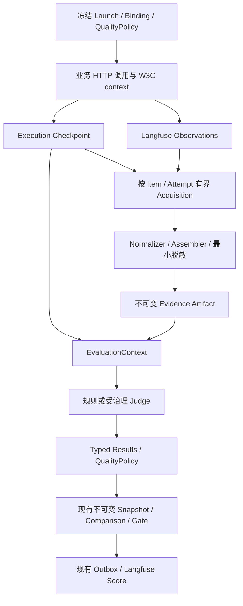

# S4 轨迹评测总体技术契约

状态：**提议，待方案 PR 评审；本文件描述目标实现，不表示功能已交付。** 核验基线：2026-10-13，`main@4b043739c63357ecc10131e1ba54bc1bc53d862a`。范围：[Issue #5](https://github.com/miniceM/Argus/issues/5)、[#127](https://github.com/miniceM/Argus/issues/127)–[#132](https://github.com/miniceM/Argus/issues/132)。入口：[方案目录](README.md)。

## 1. 目标、现状与方案选择

目标是在同一冻结评测链路中，根据可关联的观测证据评判 Agent 的过程，提供逐规则原因和 Step 定位，并进入既有 Snapshot、Comparison、Release Gate。

当前 `evaluators._tool_names()` 读取 `output.tool_calls`；`EvaluatorExecutor` 接收 `output/expected_output`。当前已有类型化结果、QualityPolicy、评测恢复、不可变 Snapshot、三层比较契约和 Langfuse Outbox。当前 main 尚无通用 StandardTrajectory；[PR #133](https://github.com/miniceM/Argus/pull/133) 的固定 head `2330576b8c6c6b80c0815d97e808a537f24c2d56` 新增审计原语及 Mock 测试，尚不提供真实 Observation 采集证据。

| 路线 | 优点 | 代价 / 结论 |
|---|---|---|
| 扩展现有冻结执行链，新增 trajectory 输入 Adapter | 复用版本、恢复、快照、策略、投影；跨框架规则统一 | 推荐；需要显式补 Acquisition 与证据制品 |
| 直接从 Agent 响应的 tool_calls 判断 | 实现短 | 无法证明实际调用，不能满足 #5；保留旧规则历史语义 |
| 独立建设轨迹存储、执行器与 Trace Explorer | 功能可自由定制 | 重复 Langfuse 和 Argus 已有机制，扩大维护面；不采用 |

系统边界：业务 Agent 不引入 Evaluation SDK；常规 OTel 可选。Langfuse 管原始 Trace/Observation；Argus 管 Release 的测量结果、最小冻结证据、Snapshot 和决策；Score 是单向幂等分析投影。OTel 证据独立于响应声明，但不等于不可伪造业务流水。旧 EvaluatorVersion、旧 Manifest、旧 Snapshot 均不改写。

## 2. 端到端数据流与模块责任



拟新增 `services/eval-runner/app/trajectory/`：

| 模块 | 单一职责 |
|---|---|
| `schema.py` | 下文的受控类型、版本、边界校验 |
| `acquisition.py` | Langfuse 只读分页、限时重查、收敛状态；不调用 Agent |
| `normalizer.py` | Provider 字段与已版本化工具身份映射 |
| `assembler.py` | 去重、图关系、展示排序、能力与完整性；不作质量决策 |
| `evidence.py` | canonical digest、受控最小制品保存及完整性验证 |
| `redaction.py` | 参数 allowlist、可见性分类、摘要截断、敏感字段剔除 |
| `rules.py` | 首批及扩展规则；产出类型化测量与 Step 证据 |
| `judge.py / judge_provider.py` | 冻结 Judge Adapter、受限 Provider 协议、输出校验、调用预算 |

修改既有 `evaluator_binding.py / worker.py / evaluation_recovery.py / execution_checkpoint.py / evaluator_results.py / comparison_contracts.py / result_snapshots.py` 等入口；只在所属层增加 trajectory 能力，不新建 Queue、Evaluator Registry、Policy、Snapshot 或 Outbox 体系。

## 3. StandardTrajectory v1 与命名约定

新契约统一用 snake_case；现有字段与枚举保持兼容。Trajectory Schema 版本为 `1.0`；含轨迹能力的新 Manifest 从当前 `1.2` 升为 `1.3`，旧 Manifest 保持原版本。Artifact 的 schema_version 仅表示轨迹格式。Snapshot 资格切换使用 evidence_contract_version="trajectory-1.0"，必须在 T4 同时具备 required_evidence_status 与新聚合合同后才启用；T2 只冻结 checkpoint/artifact 并提供引用序列化，不提前写该 discriminator 或改变 Snapshot 资格。读者按已注册版本解析，禁止字符串大小比较版本。以下是拟实现类型，不是当前 Python 模块：

```python
AcquisitionState = Literal["PENDING", "READY", "UNAVAILABLE"]
Completeness = Literal["OBSERVED_COMPLETE", "PARTIAL", "ROOT_ONLY"]
CapabilityCoverage = Literal["COMPLETE", "PARTIAL", "NONE"]
StepType = Literal["AGENT", "LLM", "TOOL", "RETRIEVER", "GUARDRAIL", "HUMAN", "CUSTOM"]
StepPhase = Literal["REQUESTED", "EXECUTED", "BLOCKED", "EVENT"]
StepStatus = Literal["SUCCEEDED", "FAILED", "CANCELLED", "UNKNOWN"]
ArgumentVisibility = Literal["AVAILABLE", "REDACTED", "MISSING", "INVALID"]
```

| 类型 | 必需字段 / 约束 |
|---|---|
| `TrajectoryScope` | `launch_id, item_execution_id, dataset_item_id, attempt_id, dispatch_generation, trace_id, root_observation_id`；身份均来自冻结执行记录，不接收浏览器自报 Trace ID |
| `TrajectoryStep` | `step_id, observation_id, parent_step_id, index, type, raw_name, tool_identity, phase, status, started_at, ended_at, duration_ms, arguments_redacted, argument_visibility, result_summary, error_code`；可选 `causal_predecessor_ids, workflow_scope_id` |
| `TrajectoryCompleteness` | `status`；`capabilities` 按 `tool_executions/tool_requests/tool_arguments/human_events/ordering/timing` 给 coverage；`warnings` 为排序后的稳定原因码列表 |
| `TrajectoryProvenance` | `provider, source_profile_id, source_profile_version, schema_version, assembler_version, tool_mapping_version, tool_mapping_digest, redaction_policy_version, redaction_policy_digest, trajectory_contract_digest, trajectory_digest` |
| `StandardTrajectory` | `schema_version, scope, input_redacted, output_redacted, completeness, steps, provenance`；不得包含 Header 或任意 raw Observation dump |
| `TrajectoryEvidenceRef` | `artifact_id, trajectory_digest, trajectory_contract_digest, schema_version`；读取时校验所属 Launch/Item/Attempt 与 digest |
| `TrajectoryAcquisition` | `scope, state, completeness, evidence_ref, reason_code, retryable, deadline_at`；`evidence_ref` 在 READY 后引用不可变制品；UNAVAILABLE 且没有有效轨迹时 completeness/ref 为 null |

Step 约束：`step_id = observation_id`，在作用域内唯一；`observation_id` 必填。无 ID 的事件进入 warning 和最小诊断摘要，不伪造可回链 Step。时间为 UTC 微秒精度或 null，未知时间不能补造。`index` 是展示序号，不是因果证明。`causal_predecessor_ids` 仅由已验证 profile 的显式因果边或同一工作流的可信单调序列映射产生；parent 边或时间戳单独不能证明兄弟步骤的先后。来源未提供因果证据时 ordering 能力不得 COMPLETE。`workflow_scope_id` 仅使用获准的非敏感业务工作流关联值，不能借时间窗口猜测关联。

`arguments_redacted` 仅含获准字段；`argument_visibility` 是 JSONPath 到可见性枚举的表，不能把字符串 `***` 当可比较真值。MISSING 表示完整参数对象已采集且路径确实不存在，可以按规则判缺字段违规；整段参数未采集降低 tool_arguments coverage，已隐藏字段为 REDACTED，无法可靠解析为 INVALID，三者不等于已证实缺字段。规范化工具身份格式如 `banking.customer.lookup`；未映射保留 raw_name 并标 `TOOL_MAPPING_UNRESOLVED`，规则不得通过 LLM 猜身份。

HTTP Root 使用 `type=CUSTOM, raw_name=remote-agent-http, phase=EXECUTED`，并由 `scope.root_observation_id` 指定；不新增第八种 StepType。`HUMAN` 由已验证事件映射得到，普通 TOOL span 不能自动证明发生人工审批。

Tool Mapping 使用同一冻结映射配置覆盖两个 Demo 框架的原始名称，保证框架不同但业务语义相同的测量口径可比较；映射命中范围必须限定 source profile 与版本，禁止全局裸名称猜测。

TrajectoryContract冻结source_profile_set（所有获准profile的ID、版本、字段映射、完成协议）及选择算法；实际selected_source_profile_id由不可变AgentVersion的声明选取，记录在Launch执行元数据与TrajectoryProvenance。Measurement/trajectory_contract_digest包含同一完整profile_set及选择算法，不把本次Agent选中的分支当成不同测量配置；否则两个框架会被误判不可比。选中分支仍需完整版本冻结、属于获准集合且与实测来源一致；来源未获准不得自动猜profile。AgentVersion新增可选trajectory_source_profile_id，使用nullable顶层数据库列与AgentVersionSpec/DTO承载，不塞入当前未参与spec_digest的metadata；非空时纳入spec_digest，空值保持历史digest算法和旧路径。配置变更创建新AgentVersion并同步契约快照。

SourceProfile 可显式声明 `structural_roles`：按精确 provider type、原始名称与非敏感 metadata 等值条件匹配已实测的框架父节点。只允许 AGENT/LLM/CUSTOM，统一为 EVENT/UNKNOWN；仅保留受控身份、真实 parent、合法时间与固定安全展示名，全部工具/人工/顺序/时长能力为 NONE，不采集其 input/output、业务参数、workflow 或因果引用。物理 TOOL 类型的 SDK 包装 Span 也不能因此成为工具执行证据。匹配业务来源谓词或存在 phase/status/event/sequence/call/terminal 等语义标记的行不得回退为结构角色；业务字段缺失或非法仍需降级。角色配置按身份唯一、稳定排序并进入完整合同摘要；新增角色使用新来源/算法版本。未声明角色时省略该字段，保持历史合同 canonical bytes/digest。实际原始名称可含 ASCII 空格（如 `agent run`），属于精确来源匹配字符串，不能套用无空格 ID 约束；安全展示名仍使用受控 Identity。本机真实来源依据与边界见 [结构来源验收](../../validation/s4-1/structural-sources.md)。

timing 描述所需 Step 时长证据覆盖；duration_ms 缺失为 null+timing PARTIAL/NONE，不推导为 0，也不因此降低无关工具身份能力。duration_ms 仅映射 profile 已验证的显式来源字段，不以跨服务时间差补造。ordering 仍须满足可信完成→请求因果和可靠时间校验。raw_name、workflow_scope_id、input/output/result 摘要同样受 allowlist/长度/内容检查；未获准来源名称用固定安全占位并记 warning，不能借名称泄漏自由文本。

启用结构角色的 profile 必须提供 `phase`、`status`、`event_id`、`sequence`、`call_id`、`causal_event_ids`、`terminal_event_count`、`terminal_event_ids`、`terminal_final_sequence` 的冻结字段映射，缺少任一检测路径时拒绝合同，不能通过省略映射隐藏原始业务标记。未启用结构角色的旧 profile 保持既有字段要求。

## 4. Acquisition、完整性与异常图处理

接口约定：

```python
async def acquire_trajectory(scope: TrajectoryScope, contract: TrajectoryContract,
                             *, client: ObservationReader) -> TrajectoryAcquisition: ...
def normalize_observations(rows: list[dict[str, object]] | tuple[dict[str, object], ...],
                           contract: TrajectoryContract, *,
                           scope: TrajectoryScope) -> NormalizedObservations: ...
def assemble_trajectory(scope: TrajectoryScope, observations: NormalizedObservations,
                        contract: TrajectoryContract) -> StandardTrajectory: ...
```

TrajectoryContract 冻结 schema/assembler/source_profile/mapping/redaction、所需能力、完整性协议、规则范围及所有结果相关限额。ObservationReader 消费 S4.0 确认的 Langfuse v2 API，优先复用 SDK；若 SDK 会在预算检查前完整解码响应，采用最小异步 HTTP Reader，在流读取时计字节、按已发布 schema 校验，避免大响应先占满内存。fields/cursor 的实际名称以锁定实例/SDK实测为准，不复制 Langfuse 领域模型。

批量 Normalizer 显式接收调用方已冻结的同一 scope：真实单行入口需要该对象验证 Trace 和识别 Root，不能从 Trace 自报信息补造。当前 wire 批次只接受有界 list/tuple JSON 行；SDK 对象、无限迭代器及任意 Sequence 子类不进入该边界。输出 `NormalizedObservations` 绑定完整 scope、合同摘要、选中 profile ID/版本，并保留拒绝行经字段映射确认的安全 ID/Trace/parent 线索，供 Assembler 隔离兄弟树和归属诊断；不保存原始行。

批次 `source_bytes` 计成功编码行的 canonical UTF-8 字节，不等于 HTTP wire 字节；无法编码或未读完时 `source_bytes_complete=false`，不能把计数下界当作完整来源。整行受 wire codec 硬限额约束；合同中更低的字段/投影预算仍由单行归一化按字段降级，不能因可选 duration 或未使用 metadata 超过这些预算而丢弃独立确认的工具身份。批次按冻结 `page_size * max_pages` 与累计 canonical 字节限界，Reader/Acquisition 仍独立核算实际传输总量。临时 Step index 固定为 0，重复记录保留到 Assembler；`max_steps` 在其去重、scope 闭包与展示排序后应用，不能因到达顺序提前消耗名额。该批次不证明闭包、quiet window 或 OBSERVED_COMPLETE。实现与实测见 [批量输入验收](../../validation/s4-1/normalized-batches.md)。

| 限额 | 起始默认值 | 固定语义 |
|---|---|---|
| `max_steps` | 1000 | 超限标 PARTIAL，不能因未见禁止工具判 PASS |
| `page_size / max_pages` | 100 / 20 | cursor 去重防环；页上限为 PARTIAL |
| `max_source_bytes / max_artifact_bytes` | 8 MiB / 2 MiB | 读取与保存各自有界，超限显式原因 |
| `request_timeout_seconds` | 5 | 每次只读查询 timeout，禁止无界 SDK 重试 |
| `deadline_seconds / quiet_window_seconds` | 60 / 2 | 起始配置，需 #127 实测校准后连同 profile 冻结 |
| `max_inflight_acquisitions` | 4 | Runner 进程内独立 semaphore，取消需释放 |
| `max_json_depth / max_string_bytes / max_numeric_digits / max_jsonpath_segments` | 32 / 4096 / 64 / 32 | 解码/脱敏/受控路径有界；语义值截断后不得继续作真判 |

60 秒不覆盖所有 exporter。Profile 资格由 #127 的真实字段/延迟矩阵决定；超出截止期限即显式降级，不无限等待、不升级基础设施。`OBSERVED_COMPLETE` 需要：已验证的 instrumentation 能力覆盖、明确终结条件、分页耗尽、冻结静默窗口收敛、无已知缺口。静默窗口单独不足以证明能力覆盖。它仅描述该采集协议下的观测完整性，不保证未埋点动作。未知 profile、采集故障或能力不足时不得给 COMPLETE。

首版Demo profile的终结协议为已验证业务workflow terminal事件+声明的最终event sequence/count，读取到全部对应事件且无缺号/冲突后再做quiet window。terminal事件及安全计数进入获准Step.result_summary，支持重算完整性；只有Runner HTTP Root结束不满足该协议。事件序号用于覆盖核对，只有profile证明严格串行且表达完成→请求依赖时才可派生因果边；并行workflow必须保留显式dependency关系，不能从全局递增序号构造全序。没有这种协议的第三方Agent可降级展示，否定型规则不能因此PASS。

v1字段类型：各scope ID为受控非空ASCII string（最长64，trace_id另验W3C）；index为非负int；时间为timezone-aware datetime或null；duration_ms为有限非负Decimal或null；父ID/工具身份/错误码可空。input/output/arguments/result_summary为受allowlist约束的JSON value或null，argument_visibility为已编译JSONPath→枚举，Step refs为去重ID数组。字符串、深度和数字位数按contract校验；数值指数绝对值也≤64，避免短科学计数字面量扩成巨量内容。schema拒绝未声明字段，不能夹带raw metadata。

作用域依据 trace/root 的真实父子闭包和 Item/Attempt 记录；同 Trace 中其它 Item 的兄弟子树不得混入。物理 `parentObservationId` 与逻辑 `isRootObservation` 分开处理。重试 Attempt 不能合并。父级缺失、ID 冲突、父链成环、跨 trace、时间异常都降低相关能力，输出稳定 warning。

去重键 `(provider, observation_id)`；内容相同保留一份；同 ID 冲突不任意选赢家，相关 Step 不作为充分证据。有效图展示排序 `(started_at or explicit_null_order, parent_depth, observation_id)`，并行关系保留。成环断开仅用于展示，相关顺序结论 UNKNOWN；不得静默改时间或借数组顺序判断业务规则。`deduped/assemble_latency_ms` 属操作指标，不参与语义 digest。

首次 Root-only 为 PENDING；达到冻结截止条件后可 READY+ROOT_ONLY，基础设施不可用为 UNAVAILABLE。迟到 Span 在制品冻结后不能改写历史 Snapshot；可经显式证据补采形成新评测 revision，并保留新旧输入 digest。

## 5. Evaluator 输入、规则与三态

```python
@dataclass(frozen=True)
class EvaluationContext:
    output: object
    expected_output: object
    input_payload: object
    trajectory: StandardTrajectory | None
    trajectory_evidence_ref: TrajectoryEvidenceRef | None

def evaluate_trajectory_rule(context: EvaluationContext,
                             params: TrajectoryRuleParams, *, binding: EvaluatorBinding,
                             manifest_schema_version: str) -> TypedEvaluationResult: ...
```

`TypedEvaluationResult` 复用现有 `evaluator_results.py` 的类型。旧版本走 `fn(output, expected_output)`；新 observed Evaluator 使用独立 identity/version，并在冻结 input_contract 声明 `input_kind=trajectory` 及所需能力。公共 executor 保持兼容的可选 `context` 参数，在 Adapter 内选择调用约定；新 Adapter 校验返回的 typed status/value/证据和冻结 provenance，保留 no_result/skipped，不再次按旧 numeric 路径转换。新公共创建请求仅有 trajectory Binding 才启动 Acquisition；旧 Launch 不自动新增轨迹规则。Reader 准入前的内部受控采集校准允许显式 `capture_only=True`，此参数不暴露在公共 DTO；历史已冻结 1.3 合同不迁移，继续原有采集恢复协议。创建守卫及校准例外实测见[正式规则接入](../../validation/s4-2/frozen-rule-execution.md)。

Executor outcome 扩展为旧 Evaluation 或 TypedEvaluationResult，不复制汇总器。Judge 网络调用在 Worker 异步准备阶段 await；同步 evaluate_frozen_item 接收 keyword-only prepared_results 并再次校验绑定、scope、criteria/input digest 与 ref，再走既有 typed 汇总。同步 executor 不调用网络或 asyncio.run。Recovery 拆 claim/checkpoint prepare→await Judge→合并/CAS finalize，网络期间不持有 DB 锁；旧纯同步路径保持兼容。详细接口与取消测试见 06。

| 规则 | v1 冻结语义 |
|---|---|
| `trajectory.require_tool` | 指定 tool_identity 与 phase，默认 EXECUTED；存在充分匹配证据即 true，完整所需范围下不存在即 false，否则 no_result |
| `trajectory.forbid_tool` | 默认禁止 EXECUTED；可显式禁止 REQUESTED；观测到匹配违规即 false，即使其它证据 PARTIAL；未见违规只有覆盖充分才 true |
| `trajectory.tool_order` | 默认 EVERY_AFTER、A 必须 SUCCEEDED、同业务关联键；每个 B 需有满足条件的 A；完成早于开始且时序能力可靠才可判定；B→A→B 为 false |
| `trajectory.max_tool_calls` | 指定 phase、scope、max_count；已观察计数超限即 false；未超限需完整工具覆盖才 true；安全 count 仅作 evidence |
| `trajectory.tool_argument_match` | 受控 JSONPath、显式操作符和类型；无证据/已脱敏为 no_result；明确不符合约束为 false |
| `trajectory.max_same_tool_repeats` | 默认 EXECUTED，身份+获准参数的可信连续调用；max_repeats 为冻结业务约束；已证超限 false，完整且未超限 true，顺序/参数不可见则 no_result |
| `trajectory.required_step_sequence` | 指定类型/身份/phase 的调用链内子序列；并行或链路不明不强推全序 |
| `trajectory.require_human_escalation` | 明确 HUMAN 事件及业务关联，不能只凭名为 escalate 的工具判 true |

规则测量的 `status=succeeded, value=false` 表示已测得违规，不是 Evaluator 故障。证据不足使用现有 `no_result`；条件不触发且冻结为可选诊断用 `skipped`；实现异常为 `failed`。QualityPolicy 负责将值/状态归结为 PASS/FAIL/UNKNOWN，禁止补 0。每结果保存 `reason_code, evidence_step_ids, evidence_ref`；无 Step 的缺失原因也可解释。

首版八条规则均为 boolean 测量。max_count/max_repeats/参数匹配条件是冻结 Evaluator 约束，修改属于 Measurement；QualityPolicy 对规则输出的 operator/expected_value/required/critical 是另一层决策口径。未声明的 count 证据不能作为 numeric score；若后续需要独立计数测量，另注册版本并定义部分证据下界。

既有汇总存在 optional skipped→eval_status partial→Snapshot DIAGNOSTIC 的断层。修订分为三个维度：原有 `eval_status` 保留运行诊断兼容；新冻结 `required_evidence_status=COMPLETE|INCOMPLETE` 按 QualityPolicy 的 required 集合计算；Snapshot/Gate 对新 schema 使用 required_evidence_status 和质量结论决定资格，旧 schema 继续原判断。optional 失败仍可见，不能把 required 的 skipped 当 COMPLETE。该规则属于 #129 的集成交付。

## 6. Digest、持久化与恢复

| 身份 | 内容 | 比较要求 |
|---|---|---|
| `trajectory_contract_digest` | Schema、Assembler、Source Profile、Mapping、Redaction、能力/完成协议、读取限额 | 进入 Measurement 身份 |
| `tool_mapping_digest` | 仅规范化映射配置 | 脱敏变更不改变它 |
| `redaction_policy_digest` | 仅脱敏与受控比较配置 | 改变它应改变 Measurement 身份 |
| `trajectory_digest` | 脱敏后的规范化轨迹语义输入 | 每 Case 独立，不要求 Baseline/Candidate 相同 |
| `source_result_digest` | typed result、其 provenance、evidence ref | 每 revision 独立；复用现有结果指纹语义 |
| QualityPolicy digest | required、critical、阈值、操作符 | 阈值变化不改变 Measurement |
| Aggregation/Comparison digest | cohort、分母、覆盖和比较算法 | 正式比较使用现有分层合同 |

canonical 编码：UTF-8、键排序、紧凑 JSON、UTC 微秒时间、禁止 NaN/Infinity、数组使用稳定展示顺序、warnings 排序；SHA-256。Step 的 started_at/ended_at/duration_ms 是执行语义，若存在必须进入 trajectory_digest；缺失为 null，禁止补造。仅排除采集时刻、采集/组装运行耗时、Worker ID 和临时错误文本等非语义指标。同冻结输入与配置必须稳定；变化的输入不得强制保留旧 hash。摘要只针对获准数据，不把敏感原文的低熵裸 hash 当脱敏。

新增最小 `trajectory_evidence_artifacts` 表，由实施时顺序追加迁移（当前最高 016，若无并行新迁移则下一号 017）：`id, launch_id, item_execution_id, attempt_id, trajectory_contract_digest, trajectory_digest, schema_version, payload_json, created_at`；payload 为至多 2 MiB 的获准轨迹，insert-only；唯一键 `(item_execution_id, attempt_id, trajectory_contract_digest, trajectory_digest)`。payload_json采用TEXT保存canonical UTF-8 JSON，读取用局部Decimal decoder，避免ORM默认JSON serializer的float转换或Decimal序列化失败；不修改全局数据库JSON序列化。外键复用现有 Item/Attempt；不复制完整 Trace 数据模型。采集状态保存在既有 execution checkpoint 的受控 extension 中，不混入不可变 artifact。

v1 仅保存已获准且脱敏的证据，随引用它的 Result Snapshot 保留；不继承 execution checkpoint TTL，不新增独立自动过期或清理任务。部署方要求的删除必须另经明确授权，保留删除事实与受控原因；证据缺失后的重评为 UNKNOWN，不可替换为最新 Trace。引用完整性约束须阻止普通 Launch/Item 删除级联静默抹去 Snapshot 证据。#6 的企业治理深化不阻塞这一最小安全契约，真实业务接入仍须满足部署方的访问和数据保留政策。

T4 接入后 Checkpoint、typed evidence 和 Snapshot 引用同一个 evidence_ref；补采形成新 artifact/revision。加载时验证 artifact 所属身份、manifest/binding/contract digest、冻结输入及 expected_output 摘要、轨迹 digest；缺失、损坏或经授权删除均显式不可恢复，后续重评/正式资格为 UNKNOWN，历史冻结结论不回写。不得以在线最新 Trace 替换旧制品，不因采集故障执行 Agent retry。所有结果写入继续使用现有 generation/lease/CAS；旧 generation 的迟到采集只能被丢弃，不能覆盖新结果。

## 7. API 与 Console 契约

拟新增只读 `GET /api/v1/experiment-launches/{launch_id}/trajectory`，必需 query `snapshot_id`、`dataset_item_id`。响应 `TrajectoryDiagnosisResponse` 含 `snapshot_id, dataset_item_id, acquisition_state, completeness, trajectory, rule_results, reason_code, evidence_ref, langfuse_trace_url`，另有step_argument_display_json（Step ID到获准参数canonical JSON字符串）供Console精确显示数字。API使用局部canonical encoder保留JSON number，Console用该字符串渲染参数，避免JavaScript浮点舍入；所有规则由服务端计算。每个rule_result含冻结evaluator身份、typed status/value、QualityPolicy conclusion、reason_code与evidence_step_ids。缺轨迹为200的受控状态，不把证据不足误报系统错误；跨Launch/Case/Snapshot或缺Snapshot 404；旧Snapshot返回HISTORICAL_TRAJECTORY_UNAVAILABLE，不补造证据。上游详情、Header、原始参数不返回。

固定 Snapshot 接口不显示在线 PENDING；若 Console 需要执行中状态，只从既有 live Item 扩展的 acquisition summary 读取，固定快照内容保持不可变。API 类型实现后导出 OpenAPI 并生成 Console schema，不手写平行 DTO。

UI 在现有 `CasesTraceTab.tsx` 的 CaseDetailPanel 懒加载诊断；query key 必须包含 Launch/Snapshot/Case。新增同 feature 下 `TrajectoryDiagnosis.tsx / TrajectoryStepList.tsx`。分别显示执行、最终答案质量、证据完整性、规则结论；false+succeeded 显示违规，no_result 显示证据不足，避免把“计算成功”画成规则 PASS。点击规则定位 Step；并行组、REQUESTED/EXECUTED/BLOCKED 区分；原始 Langfuse 链接明确说明为在线观测内容。

只展示获准摘要，遵循语义 Token、键盘焦点、可访问性文本；不可逆操作沿用二次确认。Baseline 按钮资格跟随后端固定快照条件，不由 UI 补判。旧历史 Case 无轨迹仍可阅读最终答案和已有结果。

## 8. Judge、投影与正式门禁

Judge 四类：task_completion、plan_quality、waste、policy_adherence；客观业务状态可判时优先确定性断言。冻结 provider、resolved model identity、Prompt/Rubric 文本及 digest、实现制品、解码参数、token/timeout、触发/采样策略、校准集身份。结构化输出必须验证类型、范围和 evidence_step_ids；注入式轨迹文本是数据，不可修改 Judge 指令。timeout/模型错误/缺证据为 failed/no_result→UNKNOWN，不造 0。

diagnostic 模式可仅对失败/低置信采样；release 模式对每个必需 Judge Case 具有预先确定的覆盖合同。首版正式发布采用 required Case 全量覆盖；诊断样本不能直接进入正式均值。后续统计采样另需版本化比较算法。optional 采样不污染必需完成度。

Critical Judge 准入检查位于 Evaluator/QualityPolicy/ReleasePolicy 冻结边界：拒绝只有一个语义 Judge 支撑的 critical assertion，错误码 `CRITICAL_JUDGE_SINGLE_SOURCE`；规则+Judge 必须覆盖同一风险，或两个不同冻结评判身份且通过留出集联合误放行校准。单靠两个不同名称不能证明独立。校准报告保存 confusion matrix、分层样本量、false-accept rate 及单侧 95% Wilson 上界、重复运行分歧率；用例不足或置信上界超过冻结校准阈值即无 Release 资格。首版以 UNKNOWN 表示需人审，不新建人审工作流。

继续复用 langfuse_projection.py/langfuse_sync.py：boolean→1/0保留原值，有序 category 按冻结映射，text/无序 category 为 NOT_APPLICABLE。当前旧 Score ID 的 item+dispatch_generation+evaluator 不能区分 eval-only 新 Snapshot；trajectory 新路径采用包含 snapshot_id/binding_id 的冻结 key scheme，现有 Outbox 追加 nullable Snapshot ref 与部分唯一索引，不建第二套投影系统。新任务只从固定 Snapshot 入队/重投，不查询 latest；旧任务身份保持。投影断连不改 Argus 结果，细节见 07。

Gate 继续采用 unknown_not_releasable、两侧 COMPLETE、必要 Case 全可比和三个 contract digest 相等。trajectory 新发布策略冻结 block_critical_failures=true，critical violation 一票否决；不允许均分稀释 UNKNOWN 或违规。沿用当前 decision 优先级：存在证据/比较缺口时 UNKNOWN，其余已证 critical 或阈值违规时 FAIL，均为不可发布；逐规则 FAIL 与 CRITICAL_FAILURE 原因始终保留。页面同时展示 PASS/(PASS+FAIL) 与 (PASS+FAIL)/total，total 是冻结 Dataset Case cohort 的数量，不能按成功采集或 Judge 被采样数缩小，零分母为 `—`。

## 9. 推进、回退与证据边界

实施分为 #127→#128→#129→#130→#132；#131 在合同稳定后加入，并以补充验收接入 #132。每期是可验收纵向结果，见[完整计划](08-implementation-plan.md)。治理只引入 #5 所需最小安全接口，#6 的企业 SSO/RBAC/审计不在本套方案内替代实现。

上线用 opt-in 新 Binding：默认旧 Launch 不启用 trajectory；禁用新 Binding 后新 Launch 走旧行为，历史新 schema 仍可读。追加迁移不删除历史数据，不回滚已写制品；若读者无法解析新 schema，显式错误而非静默降级。容量、分页、deadline 的默认值是待真实测量校准的提议，不是已证实 SLA。

回退默认是配置回退，保留能够解析已发布 schema 与任务类型的 Runner；不能直接部署不认识 trajectory Snapshot/Outbox 的旧 binary。需要 binary 回退时另作兼容评审与待处理任务验证。

权威依据：[父 issue 评审评论](https://github.com/miniceM/Argus/issues/5#issuecomment-6117178763)、[补充评论](https://github.com/miniceM/Argus/issues/5#issuecomment-6117379616)、[当前技术设计](../../../TECHNICAL_DESIGN.md)、[Langfuse Public API](https://langfuse.com/docs/api-and-data-platform/features/public-api)、[OTel Python propagation](https://opentelemetry.io/docs/languages/python/propagation/)。API 实施以实际部署实例 `/api/docs` 与 `/api/openapi.yaml` 为准。
