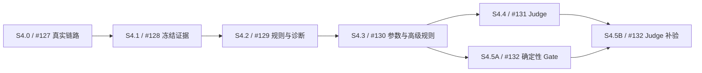

# Issue #5：S4 轨迹评测完整实施方案

**状态：提议 / 待方案评审，尚未实施。** 本文档集服务于 [#5](https://github.com/miniceM/Argus/issues/5) 及 [#127](https://github.com/miniceM/Argus/issues/127)、[#128](https://github.com/miniceM/Argus/issues/128)、[#129](https://github.com/miniceM/Argus/issues/129)、[#130](https://github.com/miniceM/Argus/issues/130)、[#131](https://github.com/miniceM/Argus/issues/131)、[#132](https://github.com/miniceM/Argus/issues/132)。文档 PR 只关联这些 issue；不使用关闭关键字，也不代表产品验收完成。

## 1. 如何阅读和执行

先读总体契约，再按完整计划选择当前任务，实施对应分期方案，最后提交验收矩阵要求的证据。本文档集作为一套评审；发生契约调整时同步所有受影响文档，不允许各分期自行解释同一枚举或 digest。

| 文档 | 内容 | 对应 issue |
|---|---|---|
| [01：总体技术契约](01-technical-design.md) | 系统边界、Schema、输入、完整性、持久化、digest、API、Judge/Gate | #5 全局 |
| [02：真实观测链路验证](02-s4-0-observation-validation.md) | 补齐 PR #133 的真实采集证据与字段矩阵 | #127 |
| [03：Acquisition / Schema / Assembler](03-s4-1-acquisition-and-schema.md) | 只读采集、归一化、图结构、最小证据制品、恢复 | #128 |
| [04：首批规则与诊断](04-s4-2-rules-and-diagnosis.md) | 四种 observed 规则、三态、optional 完整性、Case 诊断 | #129 |
| [05：参数、剩余规则与脱敏](05-s4-3-arguments-and-redaction.md) | JSONPath、参数证据、重复/顺序/HUMAN、版本化治理 | #130 |
| [06：受治理的 LLM Judge](06-s4-4-judge.md) | Adapter、版本冻结、校准、覆盖、成本和 critical 准入 | #131 |
| [07：轨迹进入 Release Gate](07-s4-5-release-gate.md) | 复用通用 Gate，分确定性与 Judge 两次接入 | #132 |
| [08：完整实施计划](08-implementation-plan.md) | 依赖、任务顺序、文件责任、RED/GREEN、交付与回退 | 全部 |
| [09：统一验收与证据矩阵](09-acceptance-matrix.md) | 验收 ID、测试层级、证据模板与 issue 关闭条件 | 全部 |

优先级：01 的公共契约是本方案的语义基线；02–07 展开各期算法与实施细节；08 规定执行顺序；09 汇总验收。详细运行 API 的已交付事实仍以 [OpenAPI](../../openapi.json) 为准；本方案中的拟新增路由在实现后才进入该快照。

## 2. 核验基线与已确认事实

核验时间：2026-10-13。main 固定提交为 [`4b043739c63357ecc10131e1ba54bc1bc53d862a`](https://github.com/miniceM/Argus/tree/4b043739c63357ecc10131e1ba54bc1bc53d862a)；[PR #133](https://github.com/miniceM/Argus/pull/133) 固定 head 为 `2330576b8c6c6b80c0815d97e808a537f24c2d56`。后续实施开始时重新核对最新 main 与该 PR，若已合并则复用代码并重新核对验收，而不是重复创建文件。

| 事实 | 对方案的约束 |
|---|---|
| 当前 main 已有冻结 Binding、Typed Results、QualityPolicy、恢复、不可变 Snapshot、三层比较与 Outbox | 直接扩展既有机制，不建平行结果系统 |
| 当前旧工具规则读取 Agent 自报 output.tool_calls | 新 observed 规则使用独立 Evaluator identity/version；旧版含义保持 |
| PR #133 有五项 CI 通过，但新用例使用 MockTransport 和手写 Observation | 可复用审计原语；#127 的真实链路门槛仍需补齐 |
| optional skipped 可导致 eval_status=partial、Snapshot=DIAGNOSTIC，虽质量仍 PASS | #129 必须补齐 required_evidence_status 到 Snapshot 的集成契约 |
| 六个 S4.* issue 尚未建立原生 sub-issue 关联，正文缺少统一依赖标注 | 本目录及 PR 显式关联 issue 并记录依赖；Refs 引用不等于已设置 GitHub 原生父子关系 |

> 🧠 **From Hindsight memory (Argus 架构与核心旅程)** — 历史设计强调业务 Agent 零 Evaluation SDK、Dataset/Agent/Evaluator/Runner 四维版本冻结，以及执行状态与质量结论分开。历史知识只用于背景；上述完成度判断以固定提交源码为准。

上一轮只读分析在现有本地 venv 中通过了 QualityPolicy、Comparison、Projection 等 74 项独立测试，并以纯函数复现 optional 完整性断层；完整 Gate/Snapshot 集成收集被缺失 `cryptography` 阻塞。这些是带日期的历史证据，不是本方案功能通过验收的证据。本方案 PR 的实际文档验证以其 PR 描述为准。

## 3. 对原 issue 的语义修订

以下是本方案提出的契约修订，需随本方案评审；不把 issue 的过时措辞当成目标实现：

| 原条款 | 本方案修订 | 负责阶段 |
|---|---|---|
| #127 两种实现 / 不依赖线上服务 | 使用本地真实 Langfuse 与真实 instrumentation；Mock 作为单元测试保留 | S4.0 |
| #128 FULL/PARTIAL/DEGRADED 一维枚举 | 分采集状态、观测完整性、能力覆盖；统一 01 的枚举 | S4.1 |
| #128 同一 Trace 多次 digest 一致 | 同一冻结输入和配置确定性一致；迟到输入变化需新 digest/revision | S4.1 |
| #129 存在一个 A→B 即合规 | 默认 EVERY_AFTER；B→A→B 不通过；作用域与状态显式 | S4.2 |
| #129 降级一律 skipped / DIAGNOSTIC | 已证实违规保留 FAIL；必要缺证据 UNKNOWN；可选诊断缺失不污染发布资格 | S4.2 |
| #130 脱敏变更使 tool_mapping_digest 变化 | redaction digest 独立，影响 Measurement；Mapping digest 仅反映映射 | S4.3 |
| #131 默认失败/低置信采样直接进入 Gate | diagnostic 可采样；首版 release required Case 全量覆盖 | S4.4 |
| #132 新增通用 UNKNOWN/Baseline/比较机制 | 复用已有实现，重点完成 trajectory 证据与契约接入 | S4.5 |

## 4. 阶段依赖与交付边界

最小脱敏和 Scope 隔离是 S4.1 的前置边界；参数规则的完整能力在 S4.3 展开。#6 的全部企业治理不阻塞隔离 Demo 的研发，但真实敏感业务接入仍受已有授权、身份与保留策略约束。#131 不阻塞确定性规则进入 Gate；关闭 #132 需完成 A、B 两组验收，关闭 #5 需六阶段全部验收。

每期以用户可验证的结果交付：真实链路→可解释的冻结轨迹→规则违规定位→安全验参→确定性 Gate→受治理 Judge→整体跨框架 Demo。保持现有 Demo v1=2/6、v2=6/6；故意轨迹违规用例使用独立 Dataset slice。

## 5. 方案范围与发布责任

本 PR 交付 Markdown 方案及导航；Schema、迁移、API、配置、测试和 UI 均是后续拟实施内容。合并本方案只表明方案进入版本控制，不能关闭产品 issue、声称真实 Trace 验收已通过或宣布上线。

实施的配置限额与时间预算是待 S4.0 测量校准的默认提议；校准阈值和 critical 业务要求必须随策略版本冻结。每阶段提交实际命令输出、固定版本、观测证据和失败条件；没有真实测试条件时标阻塞，不能用 fixture 结果代替真实链路。
