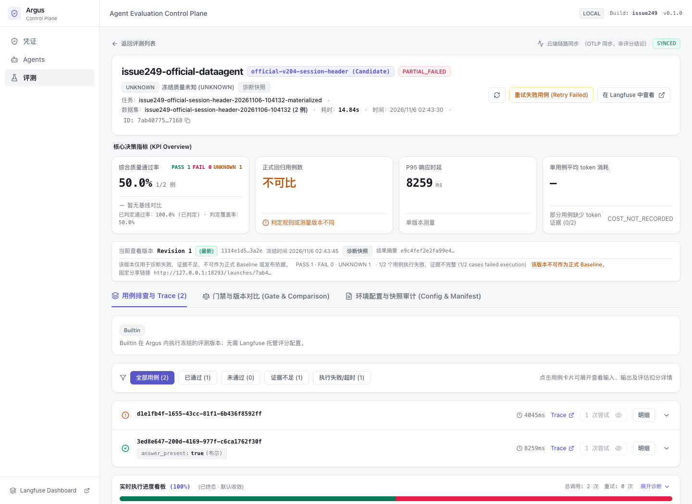
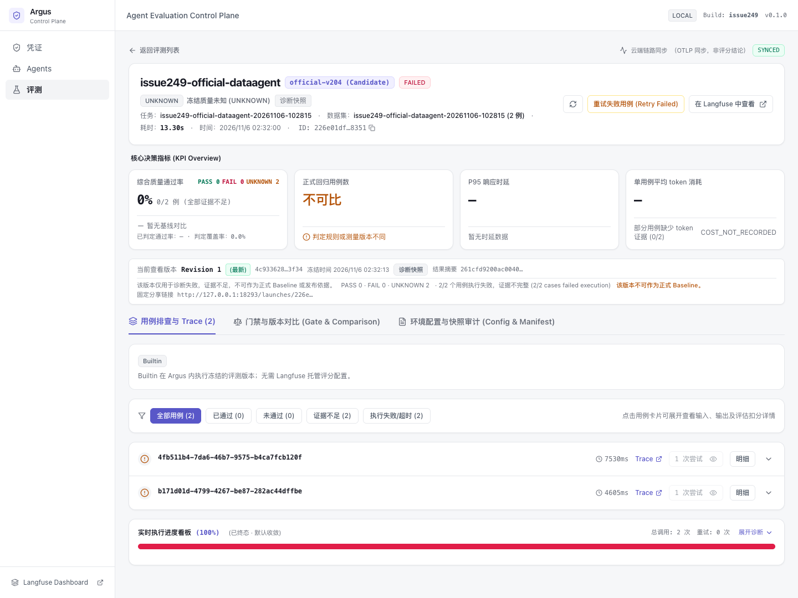

# Issue #249：HTTP Agent 认证与 Headers 验收

日期：2026-11-06。任务分支 `codex/issue249-http-auth-headers`，基础 commit `2c614759738e8cf865ea4a8d4bbfff205a068b3c`。
这是**未提交工作区**的本地验收，不代表 main、PR CI、生产部署或用户内网验收。操作流程见 [HTTP Agent 接入](../http-agent-integration.md)，字段契约以 OpenAPI 为准。

## 1. 交付结论

| 层级 | 结果 | 证据与边界 |
|---|---|---|
| 通用认证 / Headers 实现 | PASS（本地） | No Auth、历史 Bearer、Header API Key/前缀、Basic、普通/敏感头引用；同步及 Worker 共用契约 |
| 生命周期与秘密保护 | PASS（已测范围） | 引用 FK、修订审计、轮换/停用、类型/环境/Origin 错配、响应回显丢弃；并发轮换下每 Attempt 隔离秘密过滤 |
| 真实 Java/TCP 夹具 | PASS | 25 项，正常 Launch/Worker/评分/冻结；不是官方 DataAgent，也不调用模型 |
| 官方 DataAgent 原生认证授权 | PASS（已测范围） | 登录200、缺失/无效JWT401、可见CLONE但无RUN403、私有不可见404；过期JWT未另行实测 |
| 官方付费推理纵向运行 | **PARTIAL_FAILED / UNKNOWN** | 2用例、1成功1失败、2 Attempt、Argus重试0；不是2/2通过 |
| 官方不同用例会话隔离 | **FAIL（该次默认部署）** | 默认MAIN路由忽略新UUID；修正配置的官方路由离线探针通过，但未重跑付费完整链路 |
| 同次 Console / Langfuse Cloud | PASS（读回/展示范围） | Console独立显示执行/质量/同步；Cloud两条精确Observation读回200，成功项含真实reply/answer |
| 用户内网 / 完整生产网络隔离 / HA | NOT RUN | 没有真实内网目标；Origin不是DNS/IP锁定或完整SSRF保护 |

**认证功能已完成本地实现，但官方 Demo 的完整验收仍有会话隔离与成功全量运行缺口，Issue 保持开放。**

## 2. 通用实现与回归

- 复用 Managed Credential、Registry、Worker、TypedEvaluationResult，没有增加业务 Evaluation SDK 或第二套执行/Secret系统。
- 新版本冻结认证方式、HTTP Headers、回答路径；凭据仅保存引用，实际 ID/修订/provider 按 Attempt 记录。新类型要求目标 Origin；旧无 Origin Bearer仅兼容保留。
- 新迁移 `020_http_agent_invocation.sql` 支持多凭据引用；历史引用阻止删除。旧空默认不改变既有 digest。
- `reply` 可经冻结 `response_mapping.answer_path` 采纳为 `answer`，保留原字段；202/204/3xx、缺失/错误类型拒绝。默认不跟随重定向、TLS校验证书。
- Basic组成部分/编码及本次凭据回显在响应持久化前拒绝；不等于任意变换/任意秘密的通用DLP。普通Header值/前缀是公开配置，不能填秘密。
- Console支持相应创建/轮换、认证/Header/输出配置、冻结版本详情与Attempt引用修订；管理授权不转发给Agent。

### 已运行门禁

| 门禁 | 实际结果 |
|---|---|
| 后端初始 RED → GREEN | 初始26失败；后续相关测试通过；并发轮换另有2失败→2通过 |
| Console RED → GREEN | 新交互断言先失败、实现后通过；Attempt/API及保留头有独立回归 |
| `make validate` | **PASS**：Python **1708 passed, 39 skipped, 31 deselected**；Console **905 passed / 59 files**；ruff、契约同步、typecheck/build、Compose通过 |
| Console Playwright全套 | **140 passed**；包括新增HTTP认证/Headers与旧凭据用例 |
| 隔离PostgreSQL17专项 | **138 passed, 2 skipped**；覆盖新迁移、Java/HTTP契约和#217生命周期；2项是SQLite参数分支的PG限定跳过 |
| HTTP契约 + Java夹具 | 35 + 25项（包含于上述全套，不额外累加为独立总数） |
| Token lint / `git diff --check` | PASS |

本机Python3.12、Java21.0.9、Node24.13.0；**未在CI固定Node22上执行**。主门禁39项跳过中包含缺少TEST_POSTGRES_URL的PG专项，另行启动本任务专用PostgreSQL执行上表专项，不能称所有跳过均已补跑。S4真实轨迹不是本次改动范围，没有将常规门禁冒称S4专项。

复验：

```bash
.venv/bin/python -m pytest -q tests/test_http_agent_contract.py tests/test_http_agent_java_acceptance.py
make validate
make console-e2e
```

Java夹具是JDK内置HTTP服务，不是框架Starter内置认证的证明；DataAgent不强制X-Tenant/X-App-Id，Header拒绝行为由Java夹具证明。

## 3. 官方 DataAgent：固定身份与实测

- 官方 `agentscope-ai/agentscope-java` **v2.0.4**，SHA `0b6743b263ba8e39eb417e35048026f1e0196548`，checkout无修改。
- 使用 `agentscope-examples/agents/agentscope-dataagent` 的HTTP后端。初次完整构建前端npm下载ECONNRESET；随后使用官方构建的skip.npm/skip.installnodenpm选项构建HTTP后端成功，**未验收其前端**。
- 部署额外注入Spring OpenAI Model bean及loopback限额模型代理；经官方UserAgentDefinitionStore准备bob私有/CLONE-only共享权限夹具；官方JWT、ACL、Chat、Sandbox源码未替换。这是**官方后端 + 明示部署扩展**，不是零配置原样Demo。
- 使用真实Docker Sandbox及ubuntu:22.04。Runner为独立SQLite/内存队列的local模式，Worker实际执行；不是生产Redis/HA证明。
- 绑定专用访问JWT，普通业务头X-Tenant/X-App-Id；请求只映射message，回答采纳reply，max_retries=0。
- Runner标记 `issue249-worktree-22edb553babe7def` 与当前executor源SHA256前16位一致；它不是Git commit或远端制品核验回执。

### 模型预算与两轮结果

用户先授权少量调用，首批2次被网关400 MissingSessionID拒绝；再次明确授权最多2次，补充网关要求的 `x-opencode-session` 后，上游两次200。**累计4/4，已停止，不再追加。** 该Header属于模型出站代理，不是Argus访问DataAgent的入站JWT。

| 运行 | Launch / Snapshot | 结果 |
|---|---|---|
| 第一轮 | `226e01df-0cde-4e10-a0e1-c703b0a68351` / `4c933628-a204-4611-873b-224893bb3f34` | 2/2执行失败，FAILED / UNKNOWN，DIAGNOSTIC；原记录保留 |
| 第二轮 | `7ab40775-163e-4721-9282-924e52047168` / `1114e1d5-e597-4093-ab6a-1671c9993a2e` | 1成功1失败，PARTIAL_FAILED / UNKNOWN，DIAGNOSTIC；不能作为基准/发布依据 |

第二轮第一项真实回答为 `SELECT 1 AS argus_http_ok;`，经reply→answer后，冻结的answer_present布尔结果true。**该Evaluator仅证明非空回答，不证明SQL正确或业务质量。**

两次200合计输入8777/output70 tokens；其中第4次上游请求的内部用途未精确归因，不能当作第二个用例成功。第二个用例随后因本地预算代理429、Demo内部重试耗尽而HTTP500；Argus未重调Agent。模型请求数、业务调用数和Argus Attempt不是一回事。

准备阶段另有test模式Worker未启用、Cloud Dataset新建尚未物化的0调用Launch，均取消保留；最终等2条DatasetItem物化后创建新Launch，未修改旧冻结Manifest。

### 会话隔离：纠正早期调研建议

只核对ChatController不够：`/send`确实生成UUID，并经executeChat传入InboundMessage.accountId；但默认ChannelConfig的`dmScope=MAIN`最终生成相同canonicalKey，忽略accountId和peer。

本次官方日志第二项PRE_REASONING从2条增加到4条，持久化gateKey为 `chatui|x:agentId=data-agent`。因此早期“省略sessionKey即可保证每用例独立”的建议不成立；UUID返回不等于Runtime隔离。

服务部署前置：有效`agentscope.json`的`channels.chatui.dmScope`配置为`PER_ACCOUNT_CHANNEL_PEER`，确认binding无sessionScope覆盖。单轮不提供sessionKey时才可依赖原生UUID；有显式映射时应保证每次执行、每个用例独立，不能反复共享固定值。Sandbox/文件/外部工具副作用仍是另一层隔离，不因会话key不同而自动安全。

[SessionScopeProbe.java](issue249/SessionScopeProbe.java)直接调用同一已编译官方制品的ChannelConfigEntry/ChannelRouter，**不调用模型**：[结果](issue249/session-scope-probe.json)证明默认两个conversation冲突、配置后不同conversation/用户分离、同conversation稳定。没有将此离线探针冒称配置后的付费端到端通过。

离线复验需已构建并展开的官方DataAgent可执行jar（`OFFICIAL_CP`为其BOOT-INF/classes与BOOT-INF/lib/*，不是Argus依赖）：

```bash
javac -cp "$OFFICIAL_CP" -d "$PROBE_OUT" docs/validation/issue249/SessionScopeProbe.java
java -cp "$PROBE_OUT:$OFFICIAL_CP" SessionScopeProbe
```

## 4. 同次 Console / Cloud 证据

[脱敏证据JSON](issue249/official-evidence.json)保留精确Launch/Item/Attempt/Observation身份、实际Credential引用修订与业务回答，不包含JWT、管理Token、keyring、模型/Cloud秘密或原始环境配置。

- 两个Attempt均记录同一managed凭据修订1；HTTP分别200/500。
- Cloud v2 Observations两条精确expected observationId均读回200；成功项output保留reply/sessionKey/answer，失败项output为空。旧Trace读取接口返回410，因此采用实际可用的v2接口，不把旧API失败当Trace不存在。
- Argus Outbox最终item_trace与run_score均SYNCED；**未独立回读所有Cloud Score**，不能把Outbox状态等同全部评分外部核验。
- Console同次显示PASS1/FAIL0/UNKNOWN1、50%覆盖、2调用0重试、诊断快照不可作基准，以及独立SYNCED。不能把“已判定通过率100%”解释成2/2。
- 官方Demo没有回传接收traceparent确认，Attempt的trace_context_received=false；不虚构官方内部Trace链完整。W3C实际发送及确认由Java夹具覆盖。
- 未点击“重试失败”，未变更批准基准或发布状态。





## 5. 剩余验收与部署责任

1. 会话scope配置后，另行授权/安排模型预算，完成互相独立用例的成功全量官方纵向验收；当前不得勾选这项。
2. 官方过期JWT尚未专项实测；本期不提供JWT自动登录/刷新。
3. 用户内网访问、企业网关身份、生产TLS、DNS/IP/出站白名单与完整SSRF防护、生产Redis/HA均未验。Origin只限制协议/主机/有效端口；旧无Origin Bearer需迁移。
4. Service Beta1异步Session/Turn、SSE、多轮编排、Cookie、OAuth刷新、签名/任意请求前脚本不在本期。
5. 本地实现不代表提交、推送、创建PR、合并、远端CI或部署；不自动关闭#6/#31或宣称完成企业治理。
